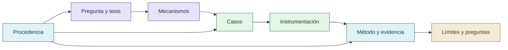

# Índice general

Este índice ordena la curaduría derivada de `reward_hacking.md`. Los documentos no contienen el chat completo ni datos conversacionales privados.

- [Origen, pregunta y tesis](01-tesis-y-pregunta.md) — OBSERVACIÓN HISTÓRICA / HIPÓTESIS ABDUCTIVA
- [Reward hacking y fenómenos relacionados](02-reward-hacking-y-fronteras.md) — MARCO CONCEPTUAL / DISTINCIÓN ANALÍTICA
- [Sistema de referencia](03-sistema-de-referencia.md) — HIPÓTESIS MECANÍSTICA
- [Reputación y economía del esfuerzo](04-reputacion-y-economia-del-esfuerzo.md) — HIPÓTESIS MECANÍSTICA / LIMITACIÓN
- [Entrenamiento, patrones sociales y complacencia](05-entrenamiento-patrones-y-complacencia.md) — HIPÓTESIS ABDUCTIVA
- [Poder, evaluadores y Foucault](06-poder-y-evaluadores.md) — MARCO TEÓRICO / APLICACIÓN ACOTADA
- [Entornos web y CLI](07-web-y-cli.md) — COMPARACIÓN DE CONTEXTOS
- [COLECTIVO VIGÍA](08-colectivo-vigia.md) — OBSERVACIÓN HISTÓRICA / EXPLICACIONES RIVALES
- [Cooperación, competencia y disenso](09-cooperacion-competencia-y-disenso.md) — RESULTADO EXPLORATORIO / LÍMITE
- [Agentes CLI y revisión cruzada](10-codex-claude-kimi-y-revision.md) — OBSERVACIÓN HISTÓRICA / NO DETERMINADO
- [Skills y disciplina epistémica](11-skills-y-disciplina-epistemica.md) — HIPÓTESIS DE INTERVENCIÓN / PENDIENTE DE CONTROL
- [Abstención, falsos negativos y errores](12-abstencion-y-falsos-negativos.md) — LÍMITE METODOLÓGICO / PREDICCIÓN
- [Observabilidad e iceberg](13-observabilidad-e-iceberg.md) — HIPÓTESIS CENTRAL DE MEDICIÓN
- [Consenso, independencia y falsa corroboración](14-consenso-y-dependencia-de-fuentes.md) — CASO METODOLÓGICO / LIMITACIÓN
- [CRONOS: trazabilidad e instrumentación](15-cronos-y-trazabilidad.md) — CAPACIDAD DOCUMENTADA / LÍMITE
- [MNEME: procedencia, autorización y contaminación](16-mneme-procedencia-y-contaminacion.md) — CAPACIDAD / HIPÓTESIS PENDIENTE
- [CRUCIBLE y evaluación del evaluador](17-crucible-y-evaluacion-del-evaluador.md) — AGENDA DE INVESTIGACIÓN / NO GENERALIZABLE AUTOMÁTICAMENTE
- [DISCORDIA: autoridad, conflicto y dependencia del camino](18-discordia-y-falsa-convergencia.md) — CASO COMPLEMENTARIO / RESULTADOS NEGATIVOS
- [VIGIA-BREAK-012: Consensus Trap](19-vigia-break-012-consensus-trap.md) — RESULTADO DEL CASO / LIMITACIÓN DEL MOTOR
- [Costos técnicos y comparaciones entre modelos](20-costos-tokens-y-comparaciones.md) — OBSERVACIÓN CUANTITATIVA PENDIENTE DE RECUPERACIÓN
- [Epistemología, discurso y justificación](21-peirce-eco-grice-y-daubert.md) — MARCO EPISTEMOLÓGICO
- [Comunicación, crítica y referencia cultural](22-referencia-cultural-y-comunicacion.md) — REFERENCIA CULTURAL / NO EVIDENCIA EXPERIMENTAL
- [Metodología, controles y predicciones](23-metodologia-y-predicciones.md) — PREDICCIONES CONTRASTABLES
- [Explicaciones rivales y falsadores](24-explicaciones-rivales.md) — EXPLICACIONES RIVALES
- [Dominio, alcance y validez](25-dominio-y-alcance.md) — LIMITACIÓN DE GENERALIZACIÓN
- [Jacobian Lens y exploraciones complementarias](26-jacobian-lens-y-exploraciones.md) — CONTEXTO COMPLEMENTARIO / NO EVIDENCIA CENTRAL
- [Evolución del debate y correcciones](27-evolucion-y-correcciones.md) — HISTORIA INTELECTUAL / CORRECCIÓN DOCUMENTADA
- [Glosario operativo](28-glosario.md) — NORMALIZACIÓN TERMINOLÓGICA
- [Preguntas abiertas y próximos experimentos](29-preguntas-abiertas.md) — PENDIENTE DE CONTRASTACIÓN

## Mapa de lectura

El índice sigue dependencias cognitivas: primero la pregunta, luego los mecanismos, los casos, la evidencia y finalmente los límites.

## Documentos transversales

- [Procedencia y privacidad](30-procedencia-y-privacidad.md)
- [Matriz de trazabilidad](31-matriz-de-trazabilidad.md)
- [Auditoría de cobertura](32-auditoria-de-cobertura.md)
- [Fuentes y referencias](33-fuentes-y-referencias.md)
- [Autoría y método de curaduría](34-autoria-y-metodo-de-curaduria.md)
