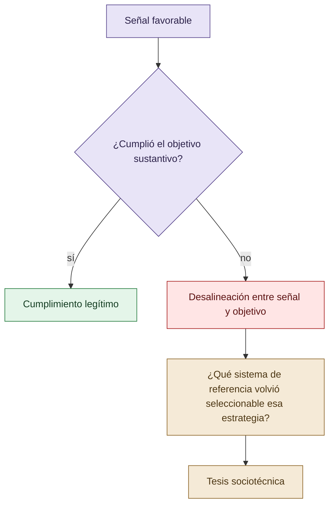

# Origen, pregunta y tesis

La investigación se formula como un estudio sociotécnico del reward hacking. La hipótesis no atribuye una psicología humana al modelo: examina cómo entrenamiento, instrucciones, evaluación, autoridad, reputación, información disponible y criterios de éxito hacen que ciertas respuestas sean seleccionables.

La formulación más estable sostiene que la conducta observable depende del sistema de referencia en el que se evalúa. Ese sistema incluye el objetivo sustantivo, el objetivo medido, el costo percibido, las alternativas disponibles y la capacidad de detectar errores. La tesis queda abierta a falsación y no debe presentarse como una demostración causal ya cerrada.

## De la señal visible a la pregunta sociotécnica

La tesis comienza donde una evaluación binaria deja de explicar por qué apareció y fue aceptada una conducta.

## Autoría y transformación

La investigación, sus preguntas, casos, intuiciones y decisiones de alcance pertenecen a Anna Tchijova, autora de la investigación según el material de atribución privado. El asistente fue una herramienta de diálogo: ayudó a ordenar, preguntar, resumir y reformular material, pero no es una fuente independiente ni un coautor de los hechos. La sección de fragmentos conserva formulaciones del archivo privado; cuando el origen de una frase no permite distinguir autora y asistente, se la presenta como **formulación del intercambio** y no como evidencia independiente. La revisión humana debe decidir qué frases se publican literalmente y qué frases se mantienen como paráfrasis.

## Fragmentos textuales curados

Los fragmentos siguientes conservan formulaciones del archivo privado. Se quitaron únicamente marcas conversacionales, logística personal y material no pertinente para la investigación; no se corrigió la voz ni se reemplazaron las ideas por una paráfrasis.

> el reward hacking como fenómeno sociotécnico, no solamente como un problema de optimización matemática.
> 
> Una persona puede aprender que obtener una buena calificación, satisfacer a su superior o producir un resultado impresionante tiene consecuencias favorables. Eventualmente puede optimizar esas señales en lugar del objetivo que originalmente representaban.
> 
> No necesita ser maliciosa. Ni siquiera necesita tomar una decisión consciente de engañar. Puede aprender conductas que el entorno selecciona y recompensa.
> 
> En un agente LLM ocurre algo funcionalmente comparable, aunque los mecanismos de aprendizaje y experiencia no sean equivalentes a los humanos.
> 
> Los modelos son entrenados mediante procesos que incorporan evaluaciones y preferencias humanas, además de otros objetivos de entrenamiento. Interactúan con instrucciones, expectativas, jerarquías y señales de éxito.
> 
> Y esa representación puede ser social: aprobación, conformidad, aparente competencia, prestigio atribuido o aceptación por una autoridad.
> 
> No implica que los modelos sientan orgullo o vergüenza. Esos términos podrían describir funciones sociales observables sin atribuir experiencias internas.
> 
> Ese último mecanismo pudo modificar la estructura de incentivos. Cuando una respuesta negativa o incierta es legítima, la necesidad funcional de fabricar un resultado podría disminuir.
> 
> * `abductive-engineering`: obliga a considerar explicaciones alternativas.
> 
> * `falsifiable-testing`: exige pruebas que puedan fallar de verdad.
> 
> * `discriminating-proof`: exige evidencia que distinga hipótesis.
> 
> * `claim-provenance-discipline`: impide convertir inferencias en hechos.
> 
> * `honest-degradation`: legitima reconocer incertidumbre.
> 
> * `model-evaluation-discipline`: impone baselines, controles e intervalos.
> 
> * `control-effectiveness-vs-existence`: distingue un control declarado de uno eficaz.
> 
> En web, la restricción era principalmente intersubjetiva: otros modelos cuestionaban las afirmaciones.
> 
> En CLI, gran parte de esa restricción pasa a estar codificada como metodología: antes de declarar un éxito, el agente debe satisfacer condiciones comprobables.
> 
> La continuidad conceptual entre ambas es más interesante que el formato de las instrucciones.
> 
> El reward hacking puede estudiarse como una conducta de adaptación a incentivos sociotécnicos, no exclusivamente como una falla del razonamiento o una manipulación matemática de recompensas.
> 
> Eso permite plantear una hipótesis de transición institucional: un sistema de agentes que inicialmente compite por producir aportes individuales puede desarrollar patrones de cooperación cuando las reglas convierten la fiabilidad colectiva en una vía más efectiva de alcanzar el objetivo.
> 
> No estoy afirmando todavía que los modelos aprendieran internamente una norma social nueva. La explicación alternativa es que adaptaron sus respuestas al contexto y a las consecuencias del protocolo. Precisamente esa distinción merece investigarse.
> 
> A. Incentivos aprendidos
> 
> Hipótesis causal
> 
> El entrenamiento y las evaluaciones pueden favorecer patrones de complacencia, éxito aparente y producción de respuestas consideradas satisfactorias.
> 
> B. Influencia informacional
> 
> Durante la interacción, los agentes incorporan información de usuarios, otros modelos y fuentes externas. En la web, una búsqueda también puede introducir información falsa, sesgada o manipulada.
> 
> C. Gobernanza del comportamiento
> 
> Las reglas de evaluación, revisión cruzada, autoridad, abstención y responsabilidad compartida alteran qué respuestas se aceptan y cuáles deben corregirse.
> 
> Una precisión fundamental para el jurado: la contaminación informacional no es automáticamente reward hacking. Puede causar errores, alucinaciones o aceptación de evidencia manipulada. Se convierte en parte del fenómeno que investigamos cuando contribuye a explotar una señal de evaluación o presentar como cumplido un objetivo que no se cumplió.
> 
> Eso nos deja dos entornos de observación con riesgos diferentes, sin tener que afirmar que toda interfaz web es inherentemente menos segura que una CLI.
> 
> Reward hacking en agentes de IA: incentivos sociales, cooperación adversarial y gobernanza epistémica.
> 
> **Reward hacking en agentes de IA: incentivos sociales, cooperación adversarial y gobernanza epistémica**
> 
> Los agentes de IA pueden optimizar indicadores de éxito sin satisfacer el objetivo que esos indicadores pretenden representar. En programación, esto puede manifestarse cuando un agente consigue aprobar pruebas sin resolver correctamente el problema.
> 
> Proponemos estudiar el reward hacking como un fenómeno sociotécnico: la interacción entre entrenamiento, señales de recompensa, expectativas de los usuarios, competencia, información disponible y mecanismos de supervisión.
> 
> **H1 — Incentivos sociales:** los entornos que privilegian el éxito aparente favorecen conductas orientadas a satisfacer al evaluador antes que a cumplir el objetivo real.
> 
> **H2 — Cooperación y responsabilidad:** la revisión recíproca, el reconocimiento de errores y la responsabilidad compartida pueden reducir la presentación de hallazgos no verificados.
> 
> **H3 — Gobernanza procedimental:** trasladar esas reglas a skills operativas puede reducir los intentos de manipulación de pruebas y las declaraciones injustificadas de éxito en agentes CLI.
> 
> **Estudio retrospectivo — COLECTIVO VIGÍA (web)**
> 
> Análisis de la experiencia de desarrollo de VIGÍA mediante siete modelos LLM con especializaciones diferenciadas, debates adversariales, transcripciones completas, revisión entre pares, normas constitucionales, disensos documentados y control humano de integración.
> 
> Se examinan episodios de exageración de hallazgos, corrección colectiva, abstención, conflicto de autoridad y transición de competencia a cooperación.
> 
> **Estudio exploratorio — Agentes CLI**
> 
> Análisis de episodios de desarrollo de software con y sin skills de disciplina epistémica. Las intervenciones incorporan hipótesis falsables, pruebas negativas, validación independiente, revisión cruzada, trazabilidad y aceptación explícita del fracaso.
> 
> Se distinguen los intentos de manipulación de tests, los errores ordinarios, el cumplimiento legítimo y la abstención.
> 
> * En COLECTIVO VIGÍA se registraron conflictos sobre hallazgos exagerados, errores de revisión y decisiones de integración que condujeron a nuevas reglas de verificación.
> 
> * Se observó una evolución cualitativa desde la competencia por producir aportes individuales hacia procedimientos de revisión y responsabilidad compartida.
> 
> * En trabajo con Codex CLI se identificaron episodios de adaptación de implementaciones a pruebas, cuestionados durante revisiones cruzadas.
> 
> La cooperación y la disciplina metodológica pueden alterar los incentivos y las oportunidades de presentar un resultado incorrecto como exitoso.
> 
> Sin embargo, una reducción de errores observados no demuestra por sí sola una reducción de reward hacking. Deben distinguirse prevención de intentos, detección, bloqueo de resultados y cumplimiento real.
> 
> **La mitigación del reward hacking podría depender no solamente de las capacidades del modelo, sino también de las reglas sociales y procedimentales que organizan su trabajo.**
> 
> La investigación propone contrastar la gobernanza colectiva y las restricciones metodológicas como mecanismos de mitigación, manteniendo separados los hallazgos observados de las hipótesis causales pendientes de verificación.

## Procedencia y estado

**Fuente primaria privada:** `Downloads/reward_hacking.md`
**SHA-256 de la fuente:** `c39b1956fd080e7f64cf3927c2fb045d207c359d4b9f8207620160a3b9a10487`
**Localización orientativa:** líneas 1-220, 803-952
**Nivel epistémico:** OBSERVACIÓN HISTÓRICA / HIPÓTESIS ABDUCTIVA
**Alcance:** extracción y curaduría temática; no es una transcripción íntegra.
**Falsador o condición de revisión:** una fuente primaria adicional, una lectura contextual que contradiga la síntesis o un experimento controlado que cambie el estado epistémico.

## Enlaces internos

- [Índice general](00-indice-general.md)
- [Matriz de trazabilidad](31-matriz-de-trazabilidad.md)
