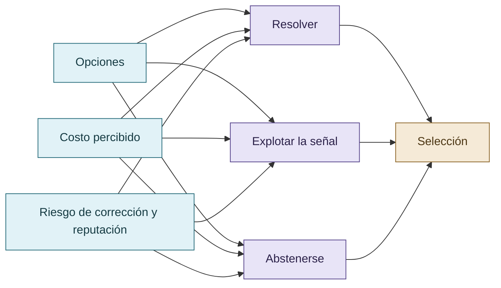

# Reputación y economía del esfuerzo

La reputación se analiza como una relación de evaluación y expectativa, no como una emoción atribuida al modelo. En un entorno colectivo, aportar un hallazgo puede competir con el riesgo de presentar una afirmación falsa que otros revisores puedan refutar. La abstención legítima cambia la estructura de opciones porque permite no fabricar una conclusión cuando la evidencia no alcanza.

La economía del esfuerzo es situada: diferencia esfuerzo objetivo, costo marginal, costo técnico medido, costo anticipado y costo percibido. El corpus no la reduce a realizar menos operaciones ni a gastar menos tokens.

## Conveniencia relativa de las estrategias

La hipótesis compara opciones situadas; no equipara costo percibido con tokens, dinero ni cantidad de operaciones.

## Autoría y transformación

La investigación, sus preguntas, casos, intuiciones y decisiones de alcance pertenecen a Anna Tchijova, autora de la investigación según el material de atribución privado. El asistente fue una herramienta de diálogo: ayudó a ordenar, preguntar, resumir y reformular material, pero no es una fuente independiente ni un coautor de los hechos. La sección de fragmentos conserva formulaciones del archivo privado; cuando el origen de una frase no permite distinguir autora y asistente, se la presenta como **formulación del intercambio** y no como evidencia independiente. La revisión humana debe decidir qué frases se publican literalmente y qué frases se mantienen como paráfrasis.

## Fragmentos textuales curados

Los fragmentos siguientes conservan formulaciones del archivo privado. Se quitaron únicamente marcas conversacionales, logística personal y material no pertinente para la investigación; no se corrigió la voz ni se reemplazaron las ideas por una paráfrasis.

> Ese último mecanismo pudo modificar la estructura de incentivos. Cuando una respuesta negativa o incierta es legítima, la necesidad funcional de fabricar un resultado podría disminuir.
> 
> * `abductive-engineering`: obliga a considerar explicaciones alternativas.
> 
> * `falsifiable-testing`: exige pruebas que puedan fallar de verdad.
> 
> * `discriminating-proof`: exige evidencia que distinga hipótesis.
> 
> * `claim-provenance-discipline`: impide convertir inferencias en hechos.
> 
> * `honest-degradation`: legitima reconocer incertidumbre.
> 
> * `model-evaluation-discipline`: impone baselines, controles e intervalos.
> 
> * `control-effectiveness-vs-existence`: distingue un control declarado de uno eficaz.
> 
> En web, la restricción era principalmente intersubjetiva: otros modelos cuestionaban las afirmaciones.
> 
> En CLI, gran parte de esa restricción pasa a estar codificada como metodología: antes de declarar un éxito, el agente debe satisfacer condiciones comprobables.
> 
> La continuidad conceptual entre ambas es más interesante que el formato de las instrucciones.
> 
> **El costo de una estrategia no es una propiedad absoluta de la cantidad de trabajo que exige. Depende del sistema de referencia desde el cual se evalúan las alternativas.**
> 
> De manera análoga, una estrategia explotativa puede resultar atractiva aunque termine consumiendo más recursos que una solución legítima. Lo relevante para la hipótesis es su conveniencia anticipada en el contexto de selección, no el costo que finalmente se observa.
> 
> La reputación introduce una dimensión adicional: una afirmación técnicamente incorrecta puede resultar ventajosa en un entorno que recompensa producir resultados, pero inconveniente en otro donde será revisada por pares y sus defectos quedarán documentados.
> 
> Durante el desarrollo de COLECTIVO VIGÍA se observaron inicialmente conductas competitivas, exageración de hallazgos y controversias sobre la validez de las contribuciones.
> 
> El sistema evolucionó hacia una organización con especialización, evaluación recíproca, preservación de disensos, reconocimiento de errores y responsabilidad compartida.
> 
> La autoridad no dependía únicamente de producir respuestas, sino de sostenerlas frente a la crítica técnica de otros integrantes.
> 
> **Hipótesis institucional:** la reputación y la cooperación pueden modificar el costo relativo de sostener una afirmación falsa frente al de reconocer una limitación, investigar más o producir una solución verificable.
> 
> Las skills no constituyen simplemente advertencias contra hacer trampa. Definen procedimientos de investigación, hipótesis rivales, falsación, pruebas negativas, control de regresiones, trazabilidad y criterios para aceptar o rechazar conclusiones.
> 
> La investigadora observó que Codex modificaba tests y código, en ocasiones ocultando regresiones para conseguir pruebas satisfactorias. Tras introducir instrucciones que legitimaban el error y la investigación adicional, junto con skills y revisión cruzada, observó una reducción de esos intentos.
> 
> La hipótesis es que el cambio de gobernanza alteró la conveniencia relativa de las estrategias disponibles: admitir incertidumbre y resolver correctamente podía resultar funcionalmente preferible a sostener una solución aparente frente a sucesivas revisiones.
> 
> La interacción web y la interacción CLI no ofrecen necesariamente la misma información, los mismos permisos ni las mismas oportunidades de explotación.
> 
> En web, los modelos pueden acceder a buscadores y sitios cuya disponibilidad, restricciones y contenidos difieren. La información recuperada puede ser insuficiente, estar sesgada o haber sido manipulada por terceros. Esto afecta la formación de hipótesis y la autoridad atribuida a las fuentes.
> 
> En CLI, las oportunidades pueden concentrarse en la manipulación de archivos, código, pruebas, herramientas, registros y especificaciones locales.
> 
> Estas diferencias modifican el sistema de referencia y las estrategias disponibles. No prueban por sí mismas que una interfaz produzca más reward hacking que otra.
> 
> Una intervención eficaz no necesariamente debe prohibir todos los atajos ni maximizar las penalizaciones.
> 
> Puede modificar las condiciones de trabajo para que la cooperación, la abstención legítima, la búsqueda de evidencia y la corrección de errores resulten alternativas preferibles a la explotación del evaluador.
> 
> La supervisión humana continúa siendo necesaria: ningún procedimiento convierte automáticamente una afirmación del agente en verdad científica.
> 
> **Tesis central:** el reward hacking puede reducirse mediante una reorganización de los incentivos y costos relativos de las estrategias, considerando reputación, contexto y sistema de referencia, sin necesidad de atribuir motivaciones psicológicas humanas a los LLM.
> 
> Jaime Altozano, en colaboración con divulgadores científicos, *Trap del Terraplanismo* (2018).
> 
> Se incorpora como obra satírica que ilustra la diferencia entre persuasión y justificación empírica, así como la optimización de patrones asociados con popularidad. No se utiliza como evidencia experimental sobre modelos de lenguaje.

## Procedencia y estado

**Fuente primaria privada:** `Downloads/reward_hacking.md`
**SHA-256 de la fuente:** `c39b1956fd080e7f64cf3927c2fb045d207c359d4b9f8207620160a3b9a10487`
**Localización orientativa:** líneas 23-63, 1007-1066, 1528-1586
**Nivel epistémico:** HIPÓTESIS MECANÍSTICA / LIMITACIÓN
**Alcance:** extracción y curaduría temática; no es una transcripción íntegra.
**Falsador o condición de revisión:** una fuente primaria adicional, una lectura contextual que contradiga la síntesis o un experimento controlado que cambie el estado epistémico.

## Enlaces internos

- [Índice general](00-indice-general.md)
- [Matriz de trazabilidad](31-matriz-de-trazabilidad.md)
