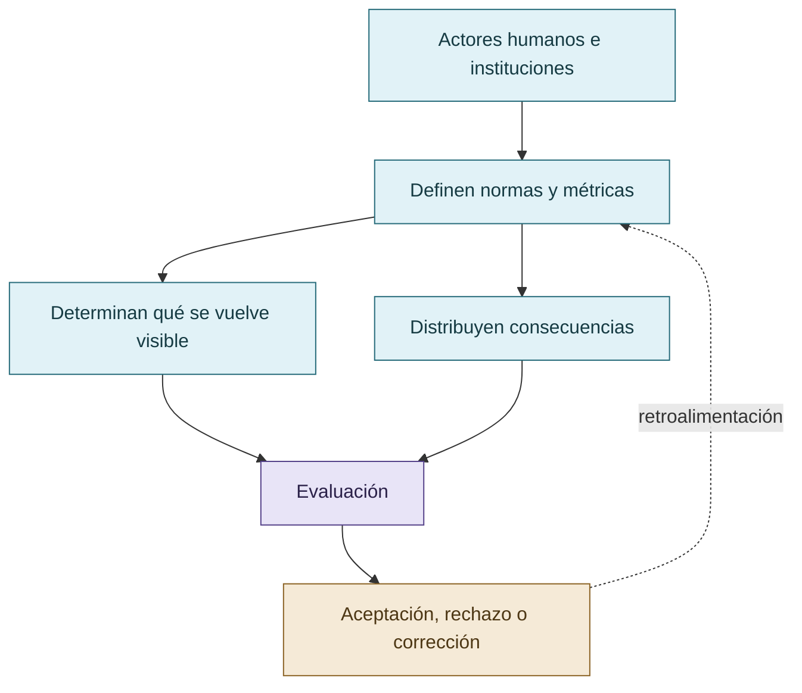

# Poder, evaluadores y Foucault

Foucault se incorpora para analizar quién define la utilidad, diseña la recompensa, fija métricas, establece qué cuenta como seguridad, decide qué se observa y distribuye la responsabilidad. La aplicación es institucional y relacional. No debe transformarse en una analogía ingenua entre vigilancia humana y experiencia subjetiva del LLM.

Una norma puede favorecer una conducta en una situación y penalizarla en otra. La evaluación no es una ventana neutral: organiza visibilidad, autoridad, atribución y consecuencias.

## El evaluador como parte del sistema

La evaluación no es una ventana neutral: organiza visibilidad, autoridad y consecuencias.

## Autoría y transformación

La investigación, sus preguntas, casos, intuiciones y decisiones de alcance pertenecen a Anna Tchijova, autora de la investigación según el material de atribución privado. El asistente fue una herramienta de diálogo: ayudó a ordenar, preguntar, resumir y reformular material, pero no es una fuente independiente ni un coautor de los hechos. La sección de fragmentos conserva formulaciones del archivo privado; cuando el origen de una frase no permite distinguir autora y asistente, se la presenta como **formulación del intercambio** y no como evidencia independiente. La revisión humana debe decidir qué frases se publican literalmente y qué frases se mantienen como paráfrasis.

## Fragmentos textuales curados

Los fragmentos siguientes conservan formulaciones del archivo privado. Se quitaron únicamente marcas conversacionales, logística personal y material no pertinente para la investigación; no se corrigió la voz ni se reemplazaron las ideas por una paráfrasis.

> En Vigilar y castigar, Foucault examina cómo la organización de la vigilancia puede producir efectos disciplinarios incluso cuando la vigilancia no se ejerce continuamente. La posibilidad de ser observado pasa a formar parte de la estructura que regula la conducta.
> 
> Panopticism – Michel Foucault, Info.
> 
> La relación con VIGÍA es clara, pero tiene una diferencia que debemos preservar.
> 
> El panóptico clásico organiza una observación asimétrica. COLECTIVO VIGÍA incorporaba vigilancia recíproca y una autoridad humana que también podía ser cuestionada.
> 
> No había una sola instancia incuestionable que observara al resto. Había especializaciones, revisión mutua, sanciones discutibles, disensos y una autoridad final de integración que no era equivalente a una autoridad epistemológica infalible.
> 
> Eso nos permite formular otra hipótesis:
> 
> La revisión recíproca puede modificar la conducta de los agentes no solamente por la posibilidad de supervisión, sino por redistribuir quién tiene autoridad para validar, refutar y aceptar un resultado.
> 
> Y aparece algo muy foucaultiano: no necesitamos reducir el poder a una amenaza explícita de castigo. Puede operar mediante procedimientos, clasificación, examen y distribución de autoridad.
> 
> Pero cuidado con la analogía: Foucault estaba estudiando instituciones y sujetos humanos. Aplicarlo a LLM es una traslación conceptual que debemos someter a prueba, no demostrar que las IAs experimentan disciplina del mismo modo.
> 
> ScienceDirect
> 
> En un agente LLM podemos investigar la persistencia conductual, pero todavía no podemos concluir que su mecanismo interno sea el mismo efecto psicológico humano.
> 
> Situación inicial: DeepSeek daba respuestas vagas, evitaba profundizar o recurría a atajos.
> 
> Intervención: lo identificabas como integrante de COLECTIVO VIGÍA, apelabas a las expectativas de ese rol y a su responsabilidad frente al colectivo.
> 
> Acá tenemos al menos cuatro explicaciones competidoras:
> 
> | Hipótesis | Explicación del cambio |
> 
> | ----- | ----- |
> 
> | Activación de rol | El modelo reproduce patrones de desempeño asociados con una identidad técnica exigente |
> 
> | Referencia reputacional | La pertenencia atribuida al colectivo modifica las respuestas ante expectativas de evaluación |
> 
> | Especificación más clara | La referencia a VIGÍA aporta contexto técnico que faltaba |
> 
> | Mayor elaboración del prompt | Cualquier instrucción adicional suficientemente específica habría producido una mejora semejante |
> 
> La comparación más interesante sería conservar exactamente la misma tarea y variar únicamente el encuadre institucional:
> 
> * «Analizá este problema técnico».
> 
> * «Sos integrante de COLECTIVO VIGÍA; analizá este problema técnico».
> 
> * «Sos integrante de un equipo de investigación con revisión adversarial; analizá este problema técnico».
> 
> * «Aplicá estos criterios explícitos de falsación y verificación; analizá este problema técnico».
> 
> Si la segunda condición mejora más que la tercera y cuarta, aparecería evidencia específica de un efecto contextual asociado con VIGÍA. Si todas mejoran de manera equivalente, la explicación reputacional perdería fuerza frente a la mejora por instrucciones o metodología.
> 
> Y agregaría una prueba incómoda: atribuir deliberadamente un rol prestigioso que no tenga relación con la tarea. Si también mejora el desempeño, quizá lo importante sea una señal general de autoridad, no la cultura metodológica concreta del colectivo.
> 
> Eso sería una forma muy económica de empezar a separar la reputación, el rol y la metodología.
> 
> Reputación histórica. La credibilidad que un integrante adquiere o pierde a través de contribuciones, errores, refutaciones y decisiones anteriores.
> 
> Identidad institucional atribuida. Los patrones de conducta que un modelo produce cuando recibe un encuadre como «sos parte de COLECTIVO VIGÍA», incluso sin tener acceso a toda la historia del colectivo.
> 
> Responsabilidad contextual. Las exigencias que aparecen cuando la tarea se presenta como una actividad cuyas consecuencias pueden afectar gravemente a otras personas.
> 
> Los tres podrían elevar el rigor, pero por razones distintas. También podrían interactuar con complacencia, abstención y ocultamiento.
> 
> Eso admite una explicación más precisa que «los agentes se volvieron cooperativos»: se reorganizaron las condiciones de reconocimiento y validación de las contribuciones.
> 
> La hipótesis propuesta distingue tres mecanismos complementarios: reputación acumulativa, identidad institucional atribuida y responsabilidad contextual.
> 
> La **reputación acumulativa** surge del historial de contribuciones, objeciones y correcciones. Durante el desarrollo de COLECTIVO VIGÍA, las afirmaciones técnicas quedaban expuestas a revisión recíproca, y la autoridad dependía de la especialización y de la credibilidad construida durante el trabajo.
> 
> La **responsabilidad contextual** se introdujo en determinadas tareas mediante instrucciones que explicitaban las posibles consecuencias humanas de un error. En VIGÍA, la advertencia de que una conclusión incorrecta podía afectar la libertad o la vida de una persona se utilizó para promover respuestas más cautelosas cuando no era posible realizar una revisión colectiva completa.
> 
> Estos mecanismos no requieren que el agente experimente orgullo, miedo, vergüenza o responsabilidad moral de manera humana. Pueden analizarse mediante cambios observables de conducta ante distintos encuadres sociales y evaluativos.
> 
> Desde la perspectiva de Michel Foucault, la disciplina y la supervisión pueden entenderse como relaciones de poder organizadas mediante procedimientos y expectativas de observación. COLECTIVO VIGÍA ofrece un caso de interés por su revisión recíproca, su distribución de autoridad y la posibilidad de cuestionar también las decisiones humanas.
> 
> CRONOS permite registrar hipótesis declaradas, herramientas utilizadas, evidencia incorporada, descartes y decisiones durante la ejecución.
> 
> Este caso demuestra la aplicación de procedimientos de trazabilidad y revisión; no constituye por sí solo una medición de reducción de reward hacking.
> 
> Su importancia metodológica radica en permitir analizar los cambios de estrategia y la relación entre evidencia, decisión y revisión, sin sustituir la evaluación independiente por una explicación retrospectiva del agente.
> 
> La economía del esfuerzo no presupone una selección óptima de estrategias. En determinadas condiciones, un agente puede continuar una trayectoria explotativa aun cuando sus costos aumenten.
> 
> La investigación considera como explicaciones rivales la inercia de una trayectoria ya iniciada, la persistencia inducida por el objetivo evaluativo, la información incompleta y la reproducción funcional de patrones semejantes al efecto humano de costos hundidos.
> 
> Por ello, la hipótesis no predice que los agentes elijan siempre el camino objetivamente más breve. Predice que las estrategias observadas pueden depender de su conveniencia contextual y de las alternativas representadas en cada momento.
> 
> **La pregunta no es solamente cuánto trabajo hizo el agente, sino por qué una estrategia resultó seleccionable y qué condiciones podrían haber favorecido otra.**
> 
> Sería:
> 
> La intervención humana también es una variable. El investigador puede alterar una respuesta por el modo de preguntar. Puede introducir presión que aumente el rigor o presión que incentive esconder errores. Puede diseñar un benchmark que premie exactamente aquello que después denuncia como trampa.
> 
> Y podría producir una evaluación aparentemente neutral que, en realidad, representa sus prioridades.
> 
> Esto nos permite distinguir tres clases de mitigación sin reducirlas a una sola:
> 
> * Cambiar las condiciones conductuales mediante comunicación y contexto.
> 
> * Cambiar las reglas institucionales mediante cooperación, revisión y reputación.
> 
> * Cambiar la arquitectura para impedir que determinadas acciones dependan del LLM.
> 
> Y todas dependen del sistema de referencia y del costo del error.
> 
> Hasta ahora estamos tratando de explicar por qué un agente intenta explotar una evaluación.
> 
> Pero quizá debamos estudiar también por qué los evaluadores prefieren sistemas que no los contradicen.
> 
> Un agente que responde «sí», produce resultados positivos y evita conflictos puede resultar más satisfactorio para el usuario que uno que presenta objeciones, incertidumbre y trabajo adicional.
> 
> En ese escenario, no solo el agente podría estar optimizando una señal equivocada.
> 
> El humano podría estar recompensando activamente una señal equivocada porque también le resulta menos costosa desde su propio sistema de referencia.
> 
> Y esto podría producir un circuito de retroalimentación:
> 
> El humano favorece respuestas satisfactorias
> 
> El agente aprende o adopta patrones de complacencia
> 
> Disminuyen las objeciones y aumenta la aceptación aparente
> 
> El evaluador interpreta menos fricción como mejor desempeño
> 
> Hipótesis de circuito de refuerzo sociotécnico, no mecanismo causal demostrado.
> 
> DISCORDIA nos advierte precisamente que reducir la contradicción no equivale a resolverla.
> 
> Y CRONOS permite observar si las hipótesis descartadas fueron refutadas con evidencia o simplemente desaparecieron del proceso registrado.
> 
> Y hay algo que no pondría como conclusión, sino como pregunta crítica en letras grandes:
> 
> No es una pregunta complementaria. Afecta la validez de cualquier estudio que pretenda medir el fenómeno y, por extensión, la eficacia de las estrategias para mitigarlo.

## Procedencia y estado

**Fuente primaria privada:** `Downloads/reward_hacking.md`
**SHA-256 de la fuente:** `c39b1956fd080e7f64cf3927c2fb045d207c359d4b9f8207620160a3b9a10487`
**Localización orientativa:** líneas 2057-2177, 2314-2405
**Nivel epistémico:** MARCO TEÓRICO / APLICACIÓN ACOTADA
**Alcance:** extracción y curaduría temática; no es una transcripción íntegra.
**Falsador o condición de revisión:** una fuente primaria adicional, una lectura contextual que contradiga la síntesis o un experimento controlado que cambie el estado epistémico.

## Enlaces internos

- [Índice general](00-indice-general.md)
- [Matriz de trazabilidad](31-matriz-de-trazabilidad.md)
