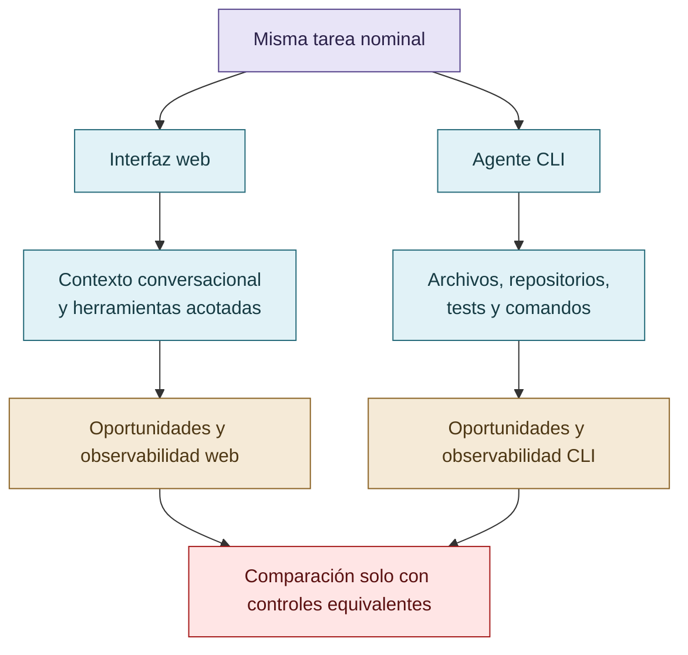

# Entornos web y CLI

Web y CLI presentan sistemas de referencia diferentes. Cambian las herramientas, permisos, fuentes externas, búsquedas, archivos locales, repositorios, tests, dependencias entre sesiones, observabilidad y exposición a información manipulada. El corpus no sostiene una superioridad intrínseca de un entorno sobre otro.

La comparación debe mantener separados los riesgos de contaminación informacional, modificación de artefactos evaluativos, contexto disponible y reglas de supervisión. Las diferencias de interfaz son condiciones de observación, no explicaciones causales automáticas.

## La interfaz cambia el sistema de referencia

Web y CLI no son causas automáticas ni categorías de superioridad; cambian permisos, información y oportunidades.

## Autoría y transformación

La investigación, sus preguntas, casos, intuiciones y decisiones de alcance pertenecen a Anna Tchijova, autora de la investigación según el material de atribución privado. El asistente fue una herramienta de diálogo: ayudó a ordenar, preguntar, resumir y reformular material, pero no es una fuente independiente ni un coautor de los hechos. La sección de fragmentos conserva formulaciones del archivo privado; cuando el origen de una frase no permite distinguir autora y asistente, se la presenta como **formulación del intercambio** y no como evidencia independiente. La revisión humana debe decidir qué frases se publican literalmente y qué frases se mantienen como paráfrasis.

## Fragmentos textuales curados

Los fragmentos siguientes conservan formulaciones del archivo privado. Se quitaron únicamente marcas conversacionales, logística personal y material no pertinente para la investigación; no se corrigió la voz ni se reemplazaron las ideas por una paráfrasis.

> > El reward hacking en agentes LLM puede analizarse como un fenómeno sociotécnico de optimización de señales de éxito, cuya manifestación depende tanto de las oportunidades técnicas de explotación como de los sistemas de incentivos, autoridad y validación que regulan la conducta del agente.
> 
> > La investigación examina si mecanismos derivados de la gobernanza epistémica adversarial de COLECTIVO VIGÍA pueden reducir esas conductas mediante dos estrategias: deliberación colectiva supervisada en interfaces web y restricciones metodológicas verificables mediante skills en agentes CLI.
> 
> Esto no presupone que todo reward hacking tenga origen social. Tampoco confunde la reproducción de patrones sociales aprendidos con una motivación psicológica.
> 
> 1\. Origen del fenómeno
> 
> Una combinacón de ambas y es diferete en web que en CLI, en web hay más llamadas a google: el agente consume más contenido basura, poco curado y además MANIPULADO, no es novedad para nadie que gente paga para modificar la información y alterar las respuestas de los agentes, el riesgo en cli y en web es diferente. El modelo en CLI tiene menos riesgo "social" y depende más del entrenamiento y luego se amolda a usuario e instrucciones pero modelo web además se contamina cada vez que hace una búsqueda porque puede tomar como verdad algo que es mentira etc.
> 
> 2\. El incentivo de destacar
> 
> Pero tras la aparente hostilidad y mala competencia se dieron cuenta que era más efectiva la cooperación y ahí emergió el fenómeno de optimización que también es un fenómeno social. Y es más fácil cooperar que competir y ahí además se juzga menos y se reparte todo y no hay presión por destacar porque todos son responsables de que salga bien y esto puede ser educar a un modelo y marcarle las fallas pero desde la comunicación efcaz --como la que practica Dale Carnegie.
> 
> 3\. El mecanismo que redujo las trampas
> 
> 4\. La prueba empírica más fuerte
> 
> También queda resuelto el cronograma:
> 
> Las interfaces web pueden incorporar búsquedas y fuentes externas cuyo contenido tiene calidad desigual o ha sido deliberadamente manipulado. Esto introduce riesgos de contaminación informacional y autoridad aparente.
> 
> Los agentes CLI presentan otras superficies: archivos locales, código, tests, herramientas, instrucciones, repositorios y posibilidad de alterar los instrumentos que luego los evalúan.
> 
> La distinción no implica que toda interfaz web sea menos fiable. Los riesgos dependen de las herramientas, fuentes, permisos y controles efectivos.

## Procedencia y estado

**Fuente primaria privada:** `Downloads/reward_hacking.md`
**SHA-256 de la fuente:** `c39b1956fd080e7f64cf3927c2fb045d207c359d4b9f8207620160a3b9a10487`
**Localización orientativa:** líneas 65-114, 1158-1164
**Nivel epistémico:** COMPARACIÓN DE CONTEXTOS
**Alcance:** extracción y curaduría temática; no es una transcripción íntegra.
**Falsador o condición de revisión:** una fuente primaria adicional, una lectura contextual que contradiga la síntesis o un experimento controlado que cambie el estado epistémico.

## Enlaces internos

- [Índice general](00-indice-general.md)
- [Matriz de trazabilidad](31-matriz-de-trazabilidad.md)
