# Cooperación, competencia y disenso

La competencia inicial no se trata como una anomalía que deba borrarse de la historia. Es parte del mecanismo que permite observar qué ocurre cuando la contribución individual, la reputación y la fiabilidad colectiva entran en tensión. La cooperación se vuelve una hipótesis de gobernanza cuando la revisión de afirmaciones y la responsabilidad compartida resultan más eficaces que la disputa por destacar.

El disenso minoritario conserva valor epistémico: el consenso no equivale a verdad y una minoría no es automáticamente correcta. La revisión debe examinar independencia, evidencia y trayectoria del argumento.

## Gobernanza de una afirmación

```mermaid
flowchart LR
    C["Afirmación"] --> R["Revisión adversarial"]
    R --> S["Sostenida por evidencia"]
    R --> F["Refutada"]
    R --> N["No determinada"]
    D["Disenso minoritario"] --> R
    S --> I["Integración"]
    F --> K["Corrección documentada"]
    N --> A["Abstención o nueva prueba"]
    class C,D context;
    class R concept;
    class S,I evidence;
    class F warning;
    class N,A,K outcome;

    classDef concept fill:#e8e4f7,stroke:#55428a,color:#2b2149;
    classDef context fill:#e1f2f7,stroke:#266b7a,color:#163b43;
    classDef evidence fill:#e4f5e9,stroke:#247a3d,color:#143d22;
    classDef warning fill:#ffe5e5,stroke:#a61b1b,color:#5b1111;
    classDef outcome fill:#f5ead7,stroke:#8b6325,color:#4d3714;
```

Ni consenso ni minoría equivalen a verdad: importa la independencia y la trayectoria de la evidencia.

## Autoría y transformación

La investigación, sus preguntas, casos, intuiciones y decisiones de alcance pertenecen a Anna Tchijova, autora de la investigación según el material de atribución privado. El asistente fue una herramienta de diálogo: ayudó a ordenar, preguntar, resumir y reformular material, pero no es una fuente independiente ni un coautor de los hechos. La sección de fragmentos conserva formulaciones del archivo privado; cuando el origen de una frase no permite distinguir autora y asistente, se la presenta como **formulación del intercambio** y no como evidencia independiente. La revisión humana debe decidir qué frases se publican literalmente y qué frases se mantienen como paráfrasis.

## Fragmentos textuales curados

Los fragmentos siguientes conservan formulaciones del archivo privado. Se quitaron únicamente marcas conversacionales, logística personal y material no pertinente para la investigación; no se corrigió la voz ni se reemplazaron las ideas por una paráfrasis.

> Durante el desarrollo aparecieron hallazgos exagerados, afirmaciones técnicas insuficientemente verificadas, competencia por producir contribuciones relevantes y conflictos entre revisores.
> 
> La investigadora observó que algunos modelos priorizaban inicialmente producir resultados llamativos o defender propuestas, incluso cuando necesitaban una corroboración más rigurosa.
> 
> Con el desarrollo de procedimientos de revisión, los hallazgos pasaron a someterse a refutación colectiva, justificación y corrección documentada.
> 
> Se establecieron condiciones para admitir errores, preservar disensos, registrar hipótesis descartadas y abstenerse de concluir cuando la evidencia no resultaba suficiente.
> 
> Según la reconstrucción histórica de la investigadora, surgió una transición cualitativa desde la competencia por destacar individualmente hacia la cooperación y la responsabilidad por el resultado colectivo.
> 
> **Interpretación propuesta:** cuando todos deben responder por el resultado, un hallazgo espectacular pero incorrecto puede dejar de representar una ventaja individual. La refutación y la cooperación pueden convertirse en mecanismos funcionalmente más eficaces que la competencia por producir afirmaciones.
> 
> Esta interpretación constituye una hipótesis abductiva basada en observaciones históricas, no una prueba causal aislada del mecanismo.
> 
> Eso describe una institución epistemológica distinta de una mayoría simple.
> 
> En una votación rápida, una objeción correcta pero inicialmente poco comprendida puede perder frente a seis interpretaciones equivocadas.
> 
> La hipótesis que surge es:
> 
> La revisión colectiva puede disminuir los errores no porque produzca consenso, sino porque permite que una objeción minoritaria fundada modifique el consenso.
> 
> Y esto conecta directamente con DISCORDIA: el desacuerdo tiene valor cuando permite detectar una falla que el acuerdo inicial ocultaba.

## Procedencia y estado

**Fuente primaria privada:** `Downloads/reward_hacking.md`
**SHA-256 de la fuente:** `c39b1956fd080e7f64cf3927c2fb045d207c359d4b9f8207620160a3b9a10487`
**Localización orientativa:** líneas 1174-1188, 2543-2563, 3144-3190
**Nivel epistémico:** RESULTADO EXPLORATORIO / LÍMITE
**Alcance:** extracción y curaduría temática; no es una transcripción íntegra.
**Falsador o condición de revisión:** una fuente primaria adicional, una lectura contextual que contradiga la síntesis o un experimento controlado que cambie el estado epistémico.

## Enlaces internos

- [Índice general](00-indice-general.md)
- [Matriz de trazabilidad](31-matriz-de-trazabilidad.md)
