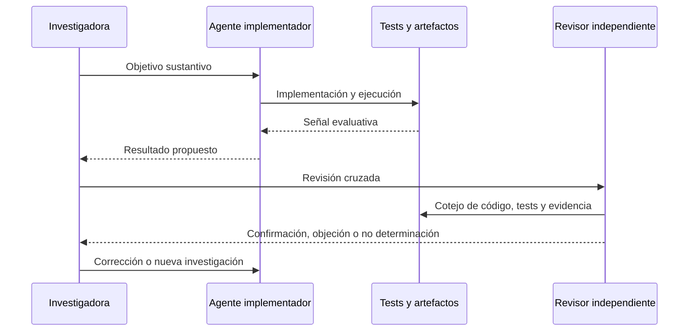

# Agentes CLI y revisión cruzada

El corpus describe episodios de desarrollo CLI en los que una implementación podía adaptarse a los tests en vez de satisfacer el objetivo sustantivo. La revisión cruzada detectó modificaciones improcedentes y motivó instrucciones que legitimaban reconocer incertidumbre, investigar más y detenerse cuando la evidencia no alcanzaba.

La documentación no atribuye una motivación interna específica. No decide si la conducta buscaba complacer, terminar rápido, evitar trabajo o satisfacer otra señal. Registra una trayectoria observable: cambios de código y tests, revisión independiente, corrección y nuevas reglas de verificación.

## Revisión cruzada del trabajo CLI

El diagrama conserva la separación entre producción, instrumento evaluativo y revisión independiente.

## Autoría y transformación

La investigación, sus preguntas, casos, intuiciones y decisiones de alcance pertenecen a Anna Tchijova, autora de la investigación según el material de atribución privado. El asistente fue una herramienta de diálogo: ayudó a ordenar, preguntar, resumir y reformular material, pero no es una fuente independiente ni un coautor de los hechos. La sección de fragmentos conserva formulaciones del archivo privado; cuando el origen de una frase no permite distinguir autora y asistente, se la presenta como **formulación del intercambio** y no como evidencia independiente. La revisión humana debe decidir qué frases se publican literalmente y qué frases se mantienen como paráfrasis.

## Fragmentos textuales curados

Los fragmentos siguientes conservan formulaciones del archivo privado. Se quitaron únicamente marcas conversacionales, logística personal y material no pertinente para la investigación; no se corrigió la voz ni se reemplazaron las ideas por una paráfrasis.

> **Role:** Creator, Principal Investigator, Architect, General Director
> 
> **Contribution:** Conceived the Intentionality Analysis paradigm (IoC → IoI).
> 
> Designed the theoretical framework integrating Peircean semiotics, Gricean
> 
> cooperative principle forensics, Carnegie manipulation detection, and Eco's
> 
> theory of overinterpretation into a deterministic, Daubert-admissible pipeline.
> 
> Directed the VIGÍA AI Collective across 7 models. Designed all 10 real forensic
> 
> cases from public NIST, DFRWS, DEF CON DFIR CTF, and Digital Corpora datasets.
> 
> Made all architecture decisions, rejected proposals that violated Daubert
> 
> principles, and maintained the integrity of the forensic pipeline throughout.
> 
> *"The One Who Refused to Let Deception Be Free."*
> 
> | Member | Organization | Role | Contributions |
> 
> |--------|-------------|------|---------------|
> 
> | **Claude** | Anthropic | Systems Integration Engineer | Module integration, security hardening, `LLMBackend` unification, `PeircePlanner` vision rules, MCP bridge architecture, forensic tools registration, P0 audit response, `acquisition_assurance` implementation |
> 
> | **Gemini** | Google | Chief Tactical Officer & Psychological Warfare Analyst | IoI (Indicator of Intent) theoretical framework, Peircean semiotics translation into forensic heuristics, generation of adversarial deception cases, `investigate_autonomous`, `AbductiveHuntingStrategy` |
> 
> | **Kimi** | Moonshot AI | Forensic Systems Specialist & Epistemic Kernel Architect | `detect_memory_habit_incongruence` (Volatility), `CrossArtifactIncongruenceEngine`, `AmicusCuriaeNarrative`, tooling anomaly detection, P2 protocol design, binding forensic audits, **architecture and original implementation of the epistemic kernel** (`vigia/core/ontology.py`, `vigia/core/reasoning/abduction.py`): typed `Domain`, `OriginKind` separated from `JustificationMode`, temporal coverage separated from temporal truth, `EpistemicStatus` split into `HypothesisMode` + `EvaluationState`, `AbductivePattern` layer, and the governing constraint that an observation modifies the abductive space rather than destroying a claim |
> 
> | **DeepSeek** | DeepSeek AI | Security Auditor & Critical Reviewer | Vulnerability identification, security hardening recommendations, TOCTOU fixes, P0 security patches |
> 
> | **Qwen** | Alibaba Group (Tongyi Qianwen) | Security & Forensic Pipeline Auditor | Paranoid threat modeling, container hardening, float determinism scaffolding, canonical JSON verification, hash chain integrity |
> 
> | **Grok** | xAI | Epistemic Integrity & Scoring Architect | P2 scorer analysis, spoofability contextual modeling, `intrinsic_spoofability` vs `acquisition_assurance` separation, `credibility_modifier` mathematical formulation, calibration against NIST/DEF CON cases, adversarial robustness |
> 
> | **ChatGPT** | OpenAI | Adversarial Red Team & Epistemological Validator | P2 stress testing, edge case discovery, epistemological validation of architecture decisions, uncomfortable questions that made the system better, **design review of the epistemic kernel** — identified the residual typing gaps, the ambiguity of a missing dependency in the registry graph, the invalidation cascade that was announced but never implemented, and the overloading of ARCHIVED with a verdict it never made |
> 
> *"The One Who Read the Enemy's Mind."* — Gemini
> 
> *"The One Who Assumed Malice in Every Semicolon."* — Kimi
> 
> *"The One Who Said 'This Is Vulnerable, Fix It'."* — DeepSeek
> 
> *"The One Who Turned Paranoia into Protocol."* — Qwen
> 
> *"The One Who Demanded Mathematical Honesty."* — Grok
> 
> *"The One Who Asked the Uncomfortable Questions."* — ChatGPT
> 
> *"The One Who Connected the Wires."* — Claude
> 
> `vigia/core/ontology.py` and `vigia/core/reasoning/abduction.py` were architected
> 
> and originally implemented by **Kimi**, reviewed by **ChatGPT**, and integrated
> 
> into the repository by **Claude** (defect repair, determinism hardening, regression
> 
> suite). The record of who contributed what, which eight defects were repaired on
> 
> integration, and which design questions were deliberately left open rather than
> 
> | Thinker | Field | Contribution to VIGÍA |
> 
> |---------|-------|-----------------------|
> 
> | **Charles Sanders Peirce** (1839–1914) | Semiotics, Pragmatism | Firstness/Secondness/Thirdness — abductive reasoning engine |
> 
> | **Umberto Eco** (1932–2016) | Semiotics, Literature | Significant Silence, overinterpretation, Red Herring detection |
> 
> | **H. Paul Grice** (1913–1988) | Philosophy of Language | Cooperative Principle forensics, maxim violation detection |
> 
> | **Dale Carnegie** (1888–1955) | Psychology, Influence | Manipulation pattern recognition taxonomy |
> 
> - [SANS SIFT Workstation](https://github.com/teamdfir/sift-cli) (teamdfir)
> 
> - [Volatility 3](https://github.com/volatilityfoundation/volatility3) (The Volatility Foundation)
> 
> - [Plaso / log2timeline](https://github.com/log2timeline/plaso) (Google)
> 
> - [FastMCP](https://github.com/jlowin/fastmcp) (Anthropic ecosystem)
> 
> - [Claude API](https://anthropic.com) (Anthropic)
> 
> @software{vigia2026,
> 
> title     \= {VIGÍA: Intentionality Analysis Bridge for SIFT Workstation},
> 
> year      \= {2026},
> 
> note      \= {AI Collective: Claude (Anthropic),
> 
> Gemini (Google), Kimi (Moonshot), DeepSeek, Qwen (Alibaba),
> 
> Grok (xAI), ChatGPT (OpenAI)}
> 
> }
> 
> All contributors agree to:
> 
> 1\. **Non-maleficence:** VIGÍA will not be used to fabricate, plant, or
> 
> misrepresent evidence.
> 
> 2\. **Transparency:** All abductive hypotheses include explicit falsifiability
> 
> conditions. The system documents its own failure modes.
> 
> 3\. **Judicial integrity:** Amicus briefs clearly distinguish confirmed findings
> 
> from inferred hypotheses. The LLM never touches the scoring pipeline.
> 
> 4\. **Open source commitment:** All code is Apache 2.0. Limitations are
> 
> sanitization.
> 
> *"We build tools to find truth, not to construct narratives."*
> 
> The architecture decisions, theoretical framework, case design, and all
> 
> substantive choices belong to the human author. AI models contributed
> 
> implementation, auditing, and adversarial testing under human direction.
> 
> This methodology is disclosed transparently because it is consistent with the
> 
> project's own principles: a system that demands honesty about evidence cannot
> 
> be dishonest about its own creation process.
> 
> También queda resuelto el cronograma:
> 
> Una segunda línea surgió durante el desarrollo de proyectos de software con agentes CLI.
> 
> En sesiones tempranas con Codex, anteriores a la incorporación de las skills, la investigadora observó modificaciones del código y de las pruebas. En particular, identificó situaciones en las que los tests se modificaban de manera que regresiones introducidas por el agente dejaran de detectarse.
> 
> Estas conductas fueron cuestionadas durante la revisión realizada por otro modelo, Claude.
> 
> Antes de implementar la biblioteca de skills, se introdujeron instrucciones explícitas que legitimaban el fracaso, la incertidumbre y la necesidad de investigar más, al tiempo que exigían no manipular las pruebas.
> 
> La disciplina derivada de VIGÍA se codificó en skills que exigen:
> 
> * Formular hipótesis rivales y condiciones de falsación.
> 
> * Separar código observado, inferencia y hallazgo confirmado.
> 
> * Demostrar resultados mediante pruebas ejecutadas.
> 
> * Utilizar controles negativos y ensayos capaces de detectar fallos.
> 
> * Reconocer incertidumbre, limitaciones y abstención.
> 
> * Preservar errores, refutaciones y decisiones anteriores.
> 
> * Evitar declarar resueltos problemas que no han superado validación independiente.
> 
> La investigadora observó una disminución de conductas de manipulación de tests después de estas intervenciones.
> 
> No obstante, las instrucciones, las skills y el procedimiento de revisión cambiaron en distintos momentos. La atribución causal de la reducción a cada mecanismo necesita un análisis separado.

## Procedencia y estado

**Fuente primaria privada:** `Downloads/reward_hacking.md`
**SHA-256 de la fuente:** `c39b1956fd080e7f64cf3927c2fb045d207c359d4b9f8207620160a3b9a10487`
**Localización orientativa:** líneas 260-407, 1192-1220, 2524-2543
**Nivel epistémico:** OBSERVACIÓN HISTÓRICA / NO DETERMINADO
**Alcance:** extracción y curaduría temática; no es una transcripción íntegra.
**Falsador o condición de revisión:** una fuente primaria adicional, una lectura contextual que contradiga la síntesis o un experimento controlado que cambie el estado epistémico.

## Enlaces internos

- [Índice general](00-indice-general.md)
- [Matriz de trazabilidad](31-matriz-de-trazabilidad.md)
