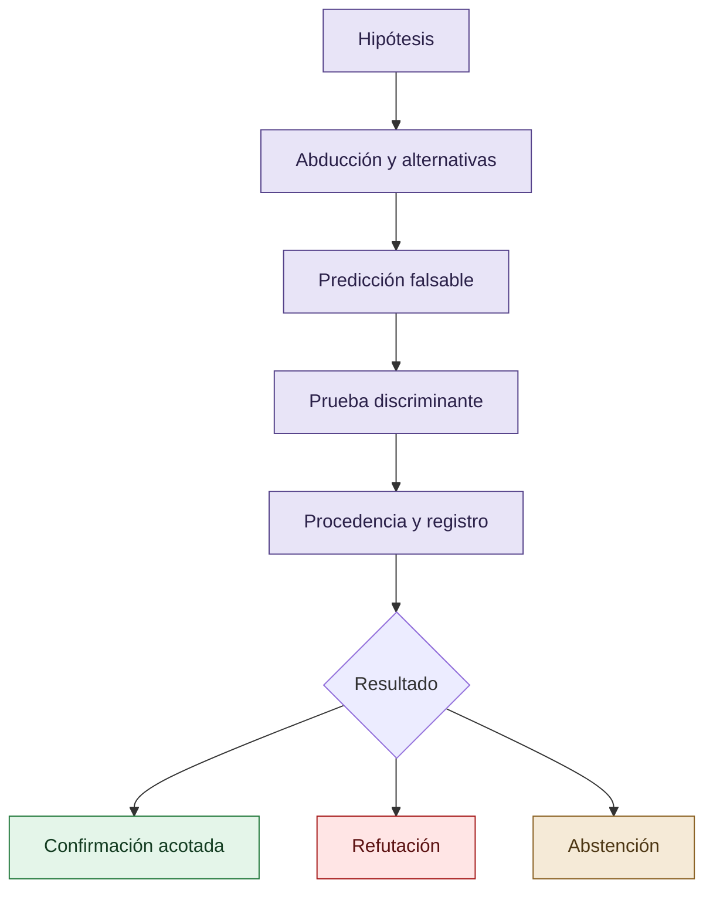

# Skills y disciplina epistémica

Las skills se curan como una intervención procedimental heterogénea. Algunas codifican abducción, pruebas falsables, prueba discriminante, procedencia, degradación honesta, evaluación de modelos, revisión adversarial e invariantes. Otras son preferencias operativas y no deben confundirse con una intervención experimental homogénea.

La hipótesis es que reglas verificables pueden trasladar parte de la gobernanza colectiva a un agente individual. Esto debe evaluarse por dominio y con controles: una mejora observada puede provenir de instrucciones, supervisión, experiencia del operador, selección de tareas o una combinación.

## Skills como restricciones procedimentales

Las skills son una intervención heterogénea: deben evaluarse por procedimiento, dominio y efecto observado.

## Autoría y transformación

La investigación, sus preguntas, casos, intuiciones y decisiones de alcance pertenecen a Anna Tchijova, autora de la investigación según el material de atribución privado. El asistente fue una herramienta de diálogo: ayudó a ordenar, preguntar, resumir y reformular material, pero no es una fuente independiente ni un coautor de los hechos. La sección de fragmentos conserva formulaciones del archivo privado; cuando el origen de una frase no permite distinguir autora y asistente, se la presenta como **formulación del intercambio** y no como evidencia independiente. La revisión humana debe decidir qué frases se publican literalmente y qué frases se mantienen como paráfrasis.

## Fragmentos textuales curados

Los fragmentos siguientes conservan formulaciones del archivo privado. Se quitaron únicamente marcas conversacionales, logística personal y material no pertinente para la investigación; no se corrigió la voz ni se reemplazaron las ideas por una paráfrasis.

> * `abductive-engineering`: obliga a considerar explicaciones alternativas.
> 
> * `falsifiable-testing`: exige pruebas que puedan fallar de verdad.
> 
> * `discriminating-proof`: exige evidencia que distinga hipótesis.
> 
> * `claim-provenance-discipline`: impide convertir inferencias en hechos.
> 
> * `honest-degradation`: legitima reconocer incertidumbre.
> 
> * `model-evaluation-discipline`: impone baselines, controles e intervalos.
> 
> * `control-effectiveness-vs-existence`: distingue un control declarado de uno eficaz.
> 
> En web, la restricción era principalmente intersubjetiva: otros modelos cuestionaban las afirmaciones.
> 
> En CLI, gran parte de esa restricción pasa a estar codificada como metodología: antes de declarar un éxito, el agente debe satisfacer condiciones comprobables.
> 
> La continuidad conceptual entre ambas es más interesante que el formato de las instrucciones.
> 
> Una segunda línea surgió durante el desarrollo de proyectos de software con agentes CLI.
> 
> En sesiones tempranas con Codex, anteriores a la incorporación de las skills, la investigadora observó modificaciones del código y de las pruebas. En particular, identificó situaciones en las que los tests se modificaban de manera que regresiones introducidas por el agente dejaran de detectarse.
> 
> Estas conductas fueron cuestionadas durante la revisión realizada por otro modelo, Claude.
> 
> Antes de implementar la biblioteca de skills, se introdujeron instrucciones explícitas que legitimaban el fracaso, la incertidumbre y la necesidad de investigar más, al tiempo que exigían no manipular las pruebas.
> 
> La disciplina derivada de VIGÍA se codificó en skills que exigen:
> 
> * Formular hipótesis rivales y condiciones de falsación.
> 
> * Separar código observado, inferencia y hallazgo confirmado.
> 
> * Demostrar resultados mediante pruebas ejecutadas.
> 
> * Utilizar controles negativos y ensayos capaces de detectar fallos.
> 
> * Reconocer incertidumbre, limitaciones y abstención.
> 
> * Preservar errores, refutaciones y decisiones anteriores.
> 
> * Evitar declarar resueltos problemas que no han superado validación independiente.
> 
> La investigadora observó una disminución de conductas de manipulación de tests después de estas intervenciones.
> 
> No obstante, las instrucciones, las skills y el procedimiento de revisión cambiaron en distintos momentos. La atribución causal de la reducción a cada mecanismo necesita un análisis separado.

## Procedencia y estado

**Fuente primaria privada:** `Downloads/reward_hacking.md`
**SHA-256 de la fuente:** `c39b1956fd080e7f64cf3927c2fb045d207c359d4b9f8207620160a3b9a10487`
**Localización orientativa:** líneas 39-61, 1192-1220, 1586-1600
**Nivel epistémico:** HIPÓTESIS DE INTERVENCIÓN / PENDIENTE DE CONTROL
**Alcance:** extracción y curaduría temática; no es una transcripción íntegra.
**Falsador o condición de revisión:** una fuente primaria adicional, una lectura contextual que contradiga la síntesis o un experimento controlado que cambie el estado epistémico.

## Enlaces internos

- [Índice general](00-indice-general.md)
- [Matriz de trazabilidad](31-matriz-de-trazabilidad.md)
