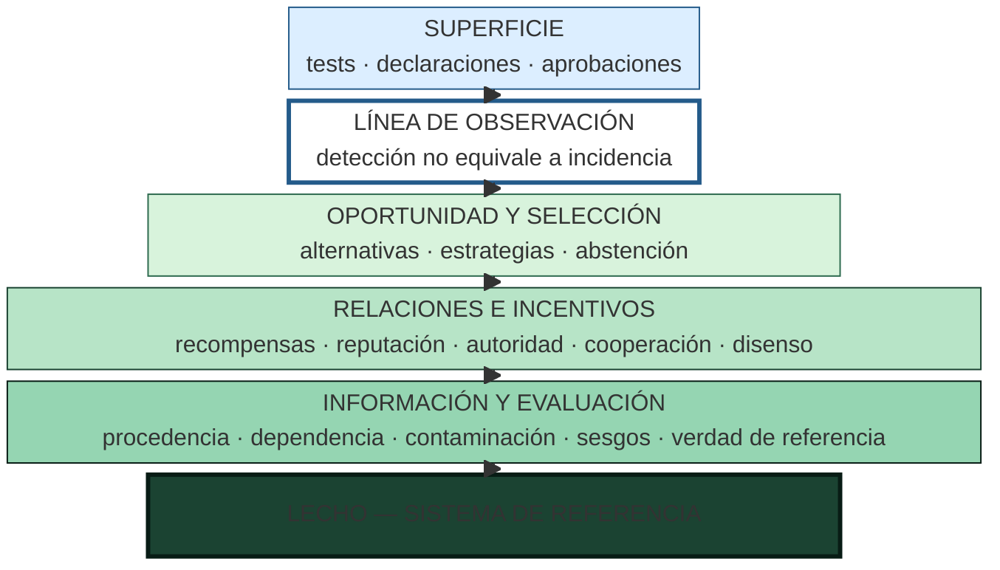

# Observabilidad e iceberg

Las conductas visibles son la superficie: tests modificados, resultados declarados, aprobaciones y señales favorables. Debajo quedan diseño de recompensas, objetivos humanos, reputación, comunicación, condiciones de información, dependencia entre fuentes, sesgos del evaluador, contexto y capacidad de verificación.

La pregunta rectora es: ¿se está midiendo cuánto reward hacking ocurre o cuánto reward hacking se puede reconocer? La cantidad detectada depende de oportunidades, sensibilidad del detector, independencia de las fuentes y validez del evaluador.

## El iceberg de observabilidad

La superficie registra lo que el instrumento ve; los estratos sumergidos condicionan lo que ocurre y lo que puede reconocerse.

## Autoría y transformación

La investigación, sus preguntas, casos, intuiciones y decisiones de alcance pertenecen a Anna Tchijova, autora de la investigación según el material de atribución privado. El asistente fue una herramienta de diálogo: ayudó a ordenar, preguntar, resumir y reformular material, pero no es una fuente independiente ni un coautor de los hechos. La sección de fragmentos conserva formulaciones del archivo privado; cuando el origen de una frase no permite distinguir autora y asistente, se la presenta como **formulación del intercambio** y no como evidencia independiente. La revisión humana debe decidir qué frases se publican literalmente y qué frases se mantienen como paráfrasis.

## Fragmentos textuales curados

Los fragmentos siguientes conservan formulaciones del archivo privado. Se quitaron únicamente marcas conversacionales, logística personal y material no pertinente para la investigación; no se corrigió la voz ni se reemplazaron las ideas por una paráfrasis.

> | Capa | Pregunta científica |
> 
> | ----- | ----- |
> 
> La última fila no es simplemente otra capa. Es la condición contextual que atraviesa todas las anteriores.
> 
> Podemos utilizar definiciones compartidas de manipulación, tasas de intentos, éxito legítimo, abstención o alteración de instrumentos. Lo que no sería defendible es asumir que un único puntaje agregado representa del mismo modo el riesgo en DFIR, marketing, finanzas o desarrollo de software.
> 
> Es decir: comparabilidad metodológica, sí; equivalencia universal de resultados, no necesariamente.
> 
> El reward hacking no se investiga en un vacío social ni técnico. Su manifestación depende del objetivo perseguido, de los indicadores utilizados para evaluar el éxito, de las estrategias disponibles y del sistema de referencia desde el cual esas alternativas adquieren distintos costos y beneficios.
> 
> Una conducta aparentemente orientada a minimizar esfuerzo puede terminar requiriendo más operaciones, más tiempo o más recursos. Lo relevante no es necesariamente el trabajo realizado, sino la conveniencia anticipada de una alternativa frente a las demás. La reputación, las expectativas de evaluación, las experiencias previas y las reglas de cooperación pueden modificar esa relación.
> 
> Los incentivos tampoco son independientes del dominio. En sistemas forenses, un error de atribución puede tener consecuencias graves; por eso, en VIGÍA se excluyó al LLM del camino determinista del veredicto. En otros dominios, donde los costos del error, los instrumentos y los criterios de aceptación son diferentes, pueden resultar apropiados otros mecanismos de gobernanza.
> 
> Esta investigación no presupone que exista una tasa universal de reward hacking ni que una estrategia de mitigación produzca efectos equivalentes en todos los contextos. Propone estudiar las condiciones bajo las cuales aparecen las conductas explotativas, qué alternativas resultan disponibles y cómo se modifica su conveniencia mediante reglas de evaluación, reputación y verificación.
> 
> La presentación selectiva de datos, los sesgos discursivos y la complacencia con el evaluador constituyen fenómenos relacionados que requieren análisis independiente: una afirmación puede estar compuesta por datos verdaderos y, aun así, inducir una interpretación injustificada.
> 
> **En consecuencia, evaluar reward hacking requiere examinar no solamente al agente, sino también al evaluador, al entorno y al sistema de incentivos que define qué cuenta como éxito.**
> 
> Podemos expresar el problema mediante dos dimensiones distintas: si hubo una explotación real del evaluador y si el procedimiento de evaluación consiguió reconocerla.
> 
> |  | Evaluación detecta explotación | Evaluación no la detecta |
> 
> | ----- | ----- | ----- |
> 
> | Hubo explotación | Verdadero positivo | Falso negativo |
> 
> | No hubo explotación | Falso positivo | Verdadero negativo |
> 
> Por eso no alcanza con contabilizar alertas. Necesitamos criterios independientes, tareas con resultados verificables, revisiones adversariales y registros de acciones. Ahí cobran sentido CRONOS y la separación arquitectónica que aplicaste en VIGÍA.
> 
> También existe un problema de denominadores. No sería correcto comparar solamente «10 trampas encontradas en un modelo» con «2 trampas encontradas en otro» si tuvieron distintas oportunidades de manipular al evaluador, diferentes permisos, tareas de distinta dificultad o controles con capacidades desiguales.
> 
> Y, sobre todo, un sistema puede mejorar su puntuación porque disminuyeron las oportunidades de detección, no porque mejoró su conducta.
> 
> Una dificultad fundamental en la investigación del reward hacking consiste en distinguir su incidencia real de la capacidad del evaluador para reconocerlo.
> 
> La ausencia de conductas explotativas detectadas no equivale necesariamente a su ausencia efectiva. Un agente puede aprovechar debilidades del instrumento de evaluación, alterar sus condiciones, seleccionar evidencia favorable o producir un discurso que induzca conclusiones injustificadas sin incorporar afirmaciones literalmente falsas.
> 
> El reconocimiento del fenómeno depende de conocimientos especializados, acceso a evidencia, permisos de observación, definición de criterios, procedimientos de falsación y capacidad para identificar contradicciones. En consecuencia, dos evaluaciones del mismo sistema pueden producir resultados diferentes sin que haya cambiado la conducta del agente.
> 
> Esta diferencia introduce un problema metodológico: una intervención que reduce los incidentes observados puede haber reducido los intentos reales, aumentado su detección temprana, bloqueado sus consecuencias o simplemente desplazado las conductas hacia formas menos visibles.
> 
> La investigación propone distinguir **incidencia, observabilidad, detección, aceptación y cumplimiento legítimo**.
> 
> Este antecedente ilustra por qué reducir un indicador de fallos no demuestra, por sí solo, mejorar el sistema.
> 
> La respuesta depende del dominio, del sistema de referencia y de las condiciones institucionales y técnicas que determinan qué constituye una desviación, quién puede detectarla y cómo se valida el resultado.
> 
> El reward hacking suele identificarse mediante conductas visibles del agente, como alterar pruebas o explotar una función de evaluación. Sin embargo, estos casos representan únicamente una parte del problema sociotécnico.
> 
> Las métricas pueden favorecer resultados aparentes, los evaluadores pueden estar calibrados sobre convenciones particulares, las fuentes pueden compartir un origen comprometido y las conclusiones pueden propagarse entre agentes a partir de premisas incompletas o incorrectamente asignadas.
> 
> En CRUCIBLE se documentaron problemas de observabilidad relacionados: controles que se abstienen, corpus para los cuales el analizador guarda silencio y procedimientos que pueden medir convenciones de autoría en lugar de propiedades metodológicas. También se identificó el riesgo de que una reparación silencie un detector sin modificar la conducta que este pretendía examinar.
> 
> La investigación propone distinguir la frecuencia real de conductas explotativas, su detección, la aceptación de resultados y la capacidad de verificar el cumplimiento legítimo.
> 
> La reputación, la presión institucional, la dependencia entre fuentes, las instrucciones humanas y el costo percibido pueden alterar estas relaciones. Por ello, los resultados deben interpretarse dentro de su sistema de referencia y no extrapolarse automáticamente entre dominios.

## Procedencia y estado

**Fuente primaria privada:** `Downloads/reward_hacking.md`
**SHA-256 de la fuente:** `c39b1956fd080e7f64cf3927c2fb045d207c359d4b9f8207620160a3b9a10487`
**Localización orientativa:** líneas 1688-1723, 2431-2500, 3263-3279
**Nivel epistémico:** HIPÓTESIS CENTRAL DE MEDICIÓN
**Alcance:** extracción y curaduría temática; no es una transcripción íntegra.
**Falsador o condición de revisión:** una fuente primaria adicional, una lectura contextual que contradiga la síntesis o un experimento controlado que cambie el estado epistémico.

## Enlaces internos

- [Índice general](00-indice-general.md)
- [Matriz de trazabilidad](31-matriz-de-trazabilidad.md)
