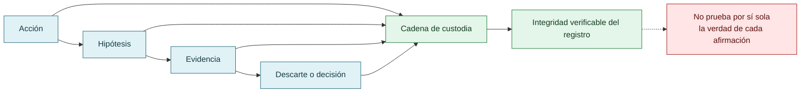

# CRONOS: trazabilidad e instrumentación

CRONOS se presenta como instrumento para registrar eventos, herramientas, hipótesis declaradas, evidencia, correcciones, descartes, decisiones, métricas de calidad y cadena criptográfica. Su valor está en conservar la trayectoria observable de una investigación.

La traza no equivale al razonamiento privado completo ni demuestra experiencias subjetivas. La integridad criptográfica prueba propiedades del registro bajo su modelo de cadena; no convierte automáticamente cada afirmación registrada en verdadera.

## Qué preserva una traza

CRONOS conserva una trayectoria observable; integridad del registro y verdad del contenido son propiedades diferentes.

## Autoría y transformación

La investigación, sus preguntas, casos, intuiciones y decisiones de alcance pertenecen a Anna Tchijova, autora de la investigación según el material de atribución privado. El asistente fue una herramienta de diálogo: ayudó a ordenar, preguntar, resumir y reformular material, pero no es una fuente independiente ni un coautor de los hechos. La sección de fragmentos conserva formulaciones del archivo privado; cuando el origen de una frase no permite distinguir autora y asistente, se la presenta como **formulación del intercambio** y no como evidencia independiente. La revisión humana debe decidir qué frases se publican literalmente y qué frases se mantienen como paráfrasis.

## Fragmentos textuales curados

Los fragmentos siguientes conservan formulaciones del archivo privado. Se quitaron únicamente marcas conversacionales, logística personal y material no pertinente para la investigación; no se corrigió la voz ni se reemplazaron las ideas por una paráfrasis.

> En esa investigación, el agente:
> 
> * Registró la hipótesis `custom_key_header_redirect_leak_class`.
> 
> * Descartó explícitamente un candidato: el cliente moderno de EventGrid no presentaba la variante investigada.
> 
> * Identificó una posible falla de alcance más general en la política de limpieza de credenciales.
> 
> * Ejecutó una inducción sobre el pipeline de Content Safety con un control discriminante.
> 
> * Conservó el resultado y las limitaciones de calidad: `MINIMAL`, diversidad `1/3`, confianza reducida a `3/5`.
> 
> Eso importa porque el expediente no registra únicamente un hallazgo exitoso. Registra hipótesis descartadas, resultados negativos, cambios de interpretación y límites de confianza.
> 
> Ese es exactamente el tipo de disciplina que puede hacer menos conveniente afirmar más de lo que se ha demostrado.
> 
> Hay una frontera técnica que debemos conservar: CRONOS registra pasos instrumentados, hipótesis declaradas y decisiones observables; no permite leer directamente el costo subjetivo ni todos los procesos internos del modelo. Tampoco el `chain_ok: true` escrito en el informe sustituye una verificación independiente de la cadena.
> 
> Pero sí permite estudiar secuencias conductuales: qué hipótesis se registraron, cuáles se abandonaron, qué nueva información apareció y qué acciones precedieron a la decisión.
> 
> Esta instrucción merece un lugar explícito en la investigación.
> 
> No era una regla matemática. No aportaba datos forenses nuevos. Tampoco garantizaba una sanción efectiva.
> 
> Modificaba el marco interpretativo de la tarea.
> 
> Pasabas de una consigna técnica a otra donde el agente recibía información sobre las posibles consecuencias humanas de equivocarse.
> 
> Esto permite proponer una hipótesis independiente:
> 
> > La explicitación de consecuencias humanas graves puede modificar la conducta observable de un agente, aun sin introducir herramientas, información técnica o mecanismos de verificación adicionales.
> 
> Las tres pueden generar respuestas aparentemente parecidas. Solo una evaluación contra resultados reales nos dirá si el mayor cuidado fue sustantivo.
> 
> Y acá hay una paradoja importante: la presión puede inducir más rigor, pero también puede inducir más manipulación, dependiendo de qué se esté presionando para conseguir.
> 
> **VIGÍA:** aporta principios de evidencia, refutación, distinción entre observación e inferencia y procedimientos deterministas de verificación. Su motor de decisión no emplea ML.
> 
> **CRONOS:** permite instrumentar y conservar trazas de acciones, herramientas, hipótesis registradas, descartes y decisiones del agente. Sus registros no equivalen a acceso completo a los estados mentales o representaciones internas del modelo.
> 
> **MNEME:** permite examinar procedencia de memorias, autorizaciones, contradicciones, exposición de decisiones a información potencialmente contaminada y determinados efectos contrafactuales verificables.
> 
> Estas herramientas ofrecen capacidades complementarias de trazabilidad. No reemplazan un evaluador independiente ni convierten una hipótesis sobre motivación en un hecho demostrado.

## Procedencia y estado

**Fuente primaria privada:** `Downloads/reward_hacking.md`
**SHA-256 de la fuente:** `c39b1956fd080e7f64cf3927c2fb045d207c359d4b9f8207620160a3b9a10487`
**Localización orientativa:** líneas 2006-2055, 1290-1298
**Nivel epistémico:** CAPACIDAD DOCUMENTADA / LÍMITE
**Alcance:** extracción y curaduría temática; no es una transcripción íntegra.
**Falsador o condición de revisión:** una fuente primaria adicional, una lectura contextual que contradiga la síntesis o un experimento controlado que cambie el estado epistémico.

## Enlaces internos

- [Índice general](00-indice-general.md)
- [Matriz de trazabilidad](31-matriz-de-trazabilidad.md)
