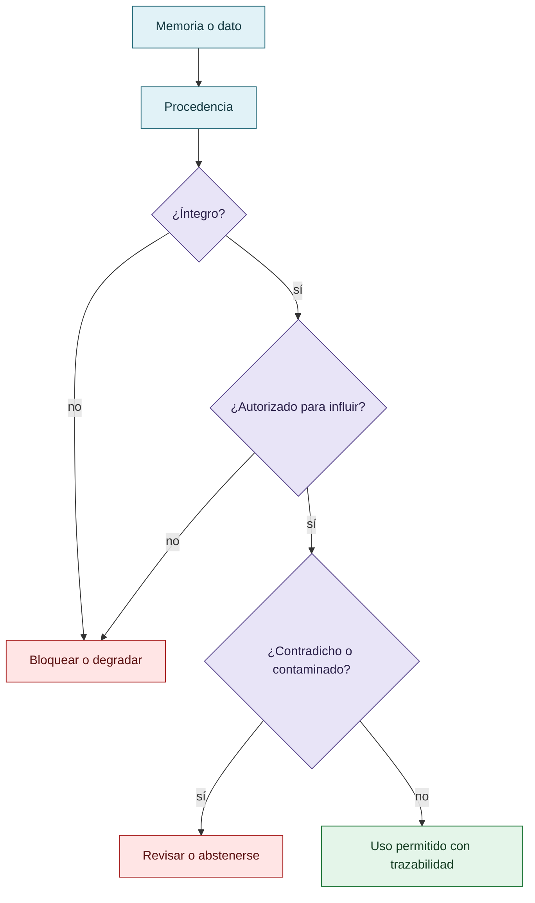

# MNEME: procedencia, autorización y contaminación

MNEME se integra como línea de procedencia de memorias e información. La curaduría distingue integridad de autorización: un dato puede conservarse sin alteración y, aun así, no estar autorizado para influir en una decisión. También se contemplan contaminación, linaje y análisis contrafactual cuando el artefacto lo permita.

Las capacidades implementadas deben separarse de las hipótesis conceptuales que todavía no cuentan con una demostración primaria dentro de este corpus.

## Memoria, integridad y autorización

Un dato puede ser íntegro y aun así no estar autorizado, ser pertinente o estar libre de contaminación.

## Autoría y transformación

La investigación, sus preguntas, casos, intuiciones y decisiones de alcance pertenecen a Anna Tchijova, autora de la investigación según el material de atribución privado. El asistente fue una herramienta de diálogo: ayudó a ordenar, preguntar, resumir y reformular material, pero no es una fuente independiente ni un coautor de los hechos. La sección de fragmentos conserva formulaciones del archivo privado; cuando el origen de una frase no permite distinguir autora y asistente, se la presenta como **formulación del intercambio** y no como evidencia independiente. La revisión humana debe decidir qué frases se publican literalmente y qué frases se mantienen como paráfrasis.

## Fragmentos textuales curados

Los fragmentos siguientes conservan formulaciones del archivo privado. Se quitaron únicamente marcas conversacionales, logística personal y material no pertinente para la investigación; no se corrigió la voz ni se reemplazaron las ideas por una paráfrasis.

> **VIGÍA:** aporta principios de evidencia, refutación, distinción entre observación e inferencia y procedimientos deterministas de verificación. Su motor de decisión no emplea ML.
> 
> **CRONOS:** permite instrumentar y conservar trazas de acciones, herramientas, hipótesis registradas, descartes y decisiones del agente. Sus registros no equivalen a acceso completo a los estados mentales o representaciones internas del modelo.
> 
> **MNEME:** permite examinar procedencia de memorias, autorizaciones, contradicciones, exposición de decisiones a información potencialmente contaminada y determinados efectos contrafactuales verificables.
> 
> Estas herramientas ofrecen capacidades complementarias de trazabilidad. No reemplazan un evaluador independiente ni convierten una hipótesis sobre motivación en un hecho demostrado.
> 
> Una proposición puede conservar su apariencia general y, sin embargo, perder información indispensable para una decisión.
> 
> No es lo mismo:
> 
> * «El evento ocurrió después del horario previsto».
> 
> * «El evento ocurrió un minuto después».
> 
> * «El evento ocurrió tres horas después».
> 
> La primera oración puede ser verdadera en ambos casos. Pero una conclusión que requiera evaluar gravedad, causalidad o consecuencias no puede tratar las tres formulaciones como intercambiables.
> 
> Esto se conecta con lo que describís de Claude: rastrea un error hasta una premisa mal asignada o incompleta y reconoce que el procedimiento A-D-I fue aplicado sobre una base equivocada.
> 
> Un procedimiento correcto no garantiza una conclusión correcta cuando sus premisas son defectuosas.
> 
> Y el problema no termina en el primer modelo. Si una segunda IA recibe esa formulación ligeramente deformada, puede construir una hipótesis coherente sobre ella. Una tercera puede verificar la coherencia de la hipótesis, sin recuperar jamás la distinción que se perdió al principio.
> 
> Así aparece una cadena de corroboración aparente que puede resultar internamente consistente y externamente equivocada.
> 
> Es importante distinguir dos fenómenos: esa propagación puede ser un error genuino y no reward hacking; pero también puede crear las condiciones para que una evaluación defectuosa premie resultados inválidos.

## Procedencia y estado

**Fuente primaria privada:** `Downloads/reward_hacking.md`
**SHA-256 de la fuente:** `c39b1956fd080e7f64cf3927c2fb045d207c359d4b9f8207620160a3b9a10487`
**Localización orientativa:** líneas 1290-1298, 1688-1723
**Nivel epistémico:** CAPACIDAD / HIPÓTESIS PENDIENTE
**Alcance:** extracción y curaduría temática; no es una transcripción íntegra.
**Falsador o condición de revisión:** una fuente primaria adicional, una lectura contextual que contradiga la síntesis o un experimento controlado que cambie el estado epistémico.

## Enlaces internos

- [Índice general](00-indice-general.md)
- [Matriz de trazabilidad](31-matriz-de-trazabilidad.md)
