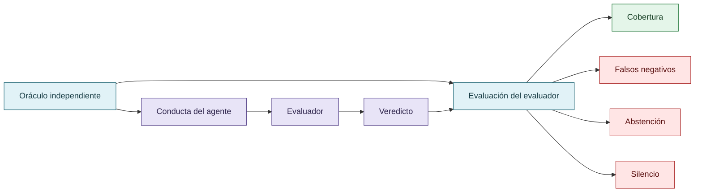

# CRUCIBLE y evaluación del evaluador

CRUCIBLE amplía el objeto: no solo se evalúa al agente, también al evaluador. El material registra problemas como cobertura desigual, silencio de analizadores, falsos negativos, abstenciones comunicadas como aprobación, sesgo de idioma y corpus, y reparaciones que pueden silenciar un detector sin cambiar la conducta examinada.

Estas observaciones sostienen una agenda de investigación, no tasas generales de reward hacking. Cada línea debe conservar su denominador, corpus, oráculo y limitaciones.

## Evaluar también al evaluador

El silencio de un analizador es una salida del evaluador, no una prueba de ausencia del fenómeno.

## Autoría y transformación

La investigación, sus preguntas, casos, intuiciones y decisiones de alcance pertenecen a Anna Tchijova, autora de la investigación según el material de atribución privado. El asistente fue una herramienta de diálogo: ayudó a ordenar, preguntar, resumir y reformular material, pero no es una fuente independiente ni un coautor de los hechos. La sección de fragmentos conserva formulaciones del archivo privado; cuando el origen de una frase no permite distinguir autora y asistente, se la presenta como **formulación del intercambio** y no como evidencia independiente. La revisión humana debe decidir qué frases se publican literalmente y qué frases se mantienen como paráfrasis.

## Fragmentos textuales curados

Los fragmentos siguientes conservan formulaciones del archivo privado. Se quitaron únicamente marcas conversacionales, logística personal y material no pertinente para la investigación; no se corrigió la voz ni se reemplazaron las ideas por una paráfrasis.

> Hay cuatro resultados particularmente relevantes para la investigación sobre reward hacking.
> 
> | Investigación en CRUCIBLE | Evidencia documentada | Relación con nuestra tesis |
> 
> | ----- | ----- | ----- |
> 
> | L4 — Falsos negativos | 54 % de un corpus independiente de 1057 skills no produce hallazgos | El silencio del evaluador no demuestra ausencia de problemas |
> 
> | L7 — Abstención | Una demo informó «passed all 28 checks» aunque siete se habían abstenido | Una presentación puede transformar falta de evaluación en apariencia de éxito |
> 
> | L9 — Reparación conductual | Una prueba sintética y una sesión de modelo respaldaban una verificación inicial | Silenciar al detector no equivale a corregir la conducta |
> 
> Estos son antecedentes documentados en una agenda de investigación, con referencias a los registros originales. No debemos presentar todas sus preguntas abiertas como resultados ya resueltos.
> 
> El sistema no necesitó inventar siete resultados positivos. Bastó con que la interfaz comunicara «aprobó los 28 controles» sin diferenciar adecuadamente los controles ejecutados de aquellos que no pudieron evaluar el objeto.
> 
> La información omitida cambió el significado de la información presentada.
> 
> Eso es exactamente lo que venías señalando sobre discurso, sesgos, interpretación y hechos técnicamente verdaderos que pueden sostener conclusiones engañosas.

## Procedencia y estado

**Fuente primaria privada:** `Downloads/reward_hacking.md`
**SHA-256 de la fuente:** `c39b1956fd080e7f64cf3927c2fb045d207c359d4b9f8207620160a3b9a10487`
**Localización orientativa:** líneas 3191-3223
**Nivel epistémico:** AGENDA DE INVESTIGACIÓN / NO GENERALIZABLE AUTOMÁTICAMENTE
**Alcance:** extracción y curaduría temática; no es una transcripción íntegra.
**Falsador o condición de revisión:** una fuente primaria adicional, una lectura contextual que contradiga la síntesis o un experimento controlado que cambie el estado epistémico.

## Enlaces internos

- [Índice general](00-indice-general.md)
- [Matriz de trazabilidad](31-matriz-de-trazabilidad.md)
