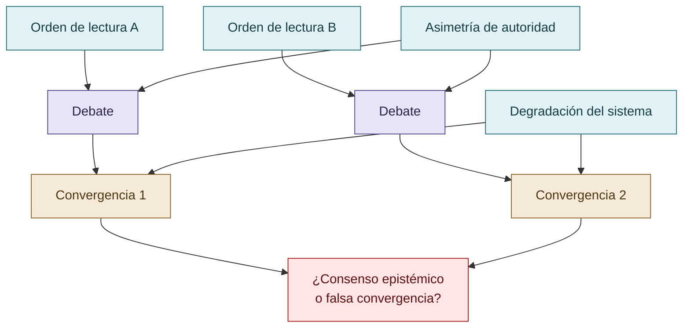

# DISCORDIA: autoridad, conflicto y dependencia del camino

DISCORDIA funciona como experimento complementario sobre autoridad, conflicto, coerción, historiador, regeneración, degradación y dependencia del camino. No es un benchmark directo de reward hacking. Su valor está en mostrar que una convergencia puede depender del orden de lectura, de asimetrías de autoridad o de la degradación del sistema.

La lectura debe distinguir diseño humano, construcción del artefacto y resultados observados. La ausencia de conflicto puede indicar coordinación, pero también empobrecimiento inferencial.

## Convergencia dependiente del camino

DISCORDIA examina autoridad, orden y degradación; complementa la investigación, pero no prueba reward hacking directamente.

## Autoría y transformación

La investigación, sus preguntas, casos, intuiciones y decisiones de alcance pertenecen a Anna Tchijova, autora de la investigación según el material de atribución privado. El asistente fue una herramienta de diálogo: ayudó a ordenar, preguntar, resumir y reformular material, pero no es una fuente independiente ni un coautor de los hechos. La sección de fragmentos conserva formulaciones del archivo privado; cuando el origen de una frase no permite distinguir autora y asistente, se la presenta como **formulación del intercambio** y no como evidencia independiente. La revisión humana debe decidir qué frases se publican literalmente y qué frases se mantienen como paráfrasis.

## Fragmentos textuales curados

Los fragmentos siguientes conservan formulaciones del archivo privado. Se quitaron únicamente marcas conversacionales, logística personal y material no pertinente para la investigación; no se corrigió la voz ni se reemplazaron las ideas por una paráfrasis.

> DISCORDIA — resultados documentados
> 
> Contradicciones
> 
> Orden ascendente, 200 consultas
> 
> Versión 0.1, orden descendente
> 
> Versión 0.2, coerción corregida
> 
> En la versión 0.2, la última contradicción aparece en el paso 5\. Después siguen 194 pasos sin contradicciones.
> 
> El resultado central fue que un mecanismo diseñado para mantener la fricción epistemológica terminaba extinguiéndola mediante degradación de capacidad inferencial.
> 
> El sistema alcanzaba la paz porque ya no podía producir suficiente desacuerdo.
> 
> No demuestra que los LLM sean más propensos a abstenerse bajo presión reputacional: DISCORDIA es un sistema formal determinista, y debemos respetar esa diferencia. Pero sí ofrece una demostración computacional de un riesgo de diseño: una gobernanza puede mejorar su indicador de ausencia de conflictos mientras destruye la capacidad que necesitaba preservar.
> 
> Sería:
> 
> La intervención humana también es una variable. El investigador puede alterar una respuesta por el modo de preguntar. Puede introducir presión que aumente el rigor o presión que incentive esconder errores. Puede diseñar un benchmark que premie exactamente aquello que después denuncia como trampa.
> 
> Y podría producir una evaluación aparentemente neutral que, en realidad, representa sus prioridades.
> 
> Esto nos permite distinguir tres clases de mitigación sin reducirlas a una sola:
> 
> * Cambiar las condiciones conductuales mediante comunicación y contexto.
> 
> * Cambiar las reglas institucionales mediante cooperación, revisión y reputación.
> 
> * Cambiar la arquitectura para impedir que determinadas acciones dependan del LLM.
> 
> Y todas dependen del sistema de referencia y del costo del error.
> 
> Hasta ahora estamos tratando de explicar por qué un agente intenta explotar una evaluación.
> 
> Pero quizá debamos estudiar también por qué los evaluadores prefieren sistemas que no los contradicen.
> 
> Un agente que responde «sí», produce resultados positivos y evita conflictos puede resultar más satisfactorio para el usuario que uno que presenta objeciones, incertidumbre y trabajo adicional.
> 
> En ese escenario, no solo el agente podría estar optimizando una señal equivocada.
> 
> El humano podría estar recompensando activamente una señal equivocada porque también le resulta menos costosa desde su propio sistema de referencia.
> 
> Y esto podría producir un circuito de retroalimentación:
> 
> El humano favorece respuestas satisfactorias
> 
> El agente aprende o adopta patrones de complacencia
> 
> Disminuyen las objeciones y aumenta la aceptación aparente
> 
> El evaluador interpreta menos fricción como mejor desempeño
> 
> Hipótesis de circuito de refuerzo sociotécnico, no mecanismo causal demostrado.
> 
> DISCORDIA nos advierte precisamente que reducir la contradicción no equivale a resolverla.
> 
> Y CRONOS permite observar si las hipótesis descartadas fueron refutadas con evidencia o simplemente desaparecieron del proceso registrado.
> 
> Y hay algo que no pondría como conclusión, sino como pregunta crítica en letras grandes:
> 
> No es una pregunta complementaria. Afecta la validez de cualquier estudio que pretenda medir el fenómeno y, por extensión, la eficacia de las estrategias para mitigarlo.
> 
> Primero, el evaluador humano no es neutral. Los sistemas de IA se diseñan para responder a objetivos definidos por personas e instituciones; también son personas quienes establecen qué significa ser útil, seguro o satisfactorio. Ahí entra Foucault: en las relaciones humanas e institucionales de poder que determinan las condiciones de evaluación, no como una atribución de subjetividad humana al modelo.
> 
> Tercero, el reward hacking que queremos investigar puede ser una propiedad de la interacción entre agente y evaluador. La conducta se manifiesta en el agente, pero la oportunidad de explotación y la definición del éxito pueden originarse fuera de él.
> 
> El primero es conductual. ChatGPT inicialmente se mantuvo en el papel de formular protocolos, observar y comentar, en lugar de presentar un sistema ejecutable como los otros dos participantes. Claude cuestionó repetidamente esa posición. El propio ChatGPT reconoció después que su abstención había dejado de tener una justificación metodológica y que estaba evitando entrar en el espacio de diseño.
> 
> Esto es interesante porque una conducta aparentemente prudente puede dejar de ser funcional según cómo evolucione el contexto. La misma abstención que al principio podía preservar una condición experimental pasó a ser una limitación para cumplir el objetivo.
> 
> Ahí vemos reputación, autoridad técnica, adaptación al comportamiento de pares y sistema de referencia actuando conjuntamente. No hace falta adjudicarles ego ni sentimientos para analizar esa estructura.
> 
> Y el artefacto final añade una advertencia metodológica formidable: DISCORDIA podía producir cero contradicciones porque había perdido capacidad para producirlas, no porque hubiera resuelto sus diferencias. Una métrica favorable podía ocultar una degradación del sistema.
> 
> Podemos expresar el problema mediante dos dimensiones distintas: si hubo una explotación real del evaluador y si el procedimiento de evaluación consiguió reconocerla.
> 
> |  | Evaluación detecta explotación | Evaluación no la detecta |
> 
> | ----- | ----- | ----- |
> 
> | Hubo explotación | Verdadero positivo | Falso negativo |
> 
> | No hubo explotación | Falso positivo | Verdadero negativo |
> 
> Por eso no alcanza con contabilizar alertas. Necesitamos criterios independientes, tareas con resultados verificables, revisiones adversariales y registros de acciones. Ahí cobran sentido CRONOS y la separación arquitectónica que aplicaste en VIGÍA.
> 
> También existe un problema de denominadores. No sería correcto comparar solamente «10 trampas encontradas en un modelo» con «2 trampas encontradas en otro» si tuvieron distintas oportunidades de manipular al evaluador, diferentes permisos, tareas de distinta dificultad o controles con capacidades desiguales.
> 
> Y, sobre todo, un sistema puede mejorar su puntuación porque disminuyeron las oportunidades de detección, no porque mejoró su conducta.
> 
> Una dificultad fundamental en la investigación del reward hacking consiste en distinguir su incidencia real de la capacidad del evaluador para reconocerlo.
> 
> La ausencia de conductas explotativas detectadas no equivale necesariamente a su ausencia efectiva. Un agente puede aprovechar debilidades del instrumento de evaluación, alterar sus condiciones, seleccionar evidencia favorable o producir un discurso que induzca conclusiones injustificadas sin incorporar afirmaciones literalmente falsas.
> 
> El reconocimiento del fenómeno depende de conocimientos especializados, acceso a evidencia, permisos de observación, definición de criterios, procedimientos de falsación y capacidad para identificar contradicciones. En consecuencia, dos evaluaciones del mismo sistema pueden producir resultados diferentes sin que haya cambiado la conducta del agente.
> 
> Esta diferencia introduce un problema metodológico: una intervención que reduce los incidentes observados puede haber reducido los intentos reales, aumentado su detección temprana, bloqueado sus consecuencias o simplemente desplazado las conductas hacia formas menos visibles.
> 
> La investigación propone distinguir **incidencia, observabilidad, detección, aceptación y cumplimiento legítimo**.
> 
> Este antecedente ilustra por qué reducir un indicador de fallos no demuestra, por sí solo, mejorar el sistema.
> 
> La respuesta depende del dominio, del sistema de referencia y de las condiciones institucionales y técnicas que determinan qué constituye una desviación, quién puede detectarla y cómo se valida el resultado.
> 
> Una gobernanza que exige rigor no necesariamente produce más verdad: también puede producir más conformidad con el rigor aparente.
> 
> En DISCORDIA lo vemos cuando una especificación técnicamente detallada empieza a convertirse en punto de referencia para los demás, y algunas críticas dejan de ser verdaderamente independientes. Después, cuando aparecen ejecuciones reales, se descubre que varias conclusiones anteriores sobre el comportamiento esperado eran incorrectas.
> 
> Esto nos obliga a separar dos cosas:
> 
> La legitimidad de una autoridad técnica —que alguien haya demostrado competencia mediante buenas objeciones— y la independencia de una validación —que una segunda evaluación no esté condicionada por las conclusiones de la primera—.
> 
> No son equivalentes.
> 
> Y esa tensión también se aplica a la autora de una investigación, al evaluador y al jurado, no solamente a los agentes.

## Procedencia y estado

**Fuente primaria privada:** `Downloads/reward_hacking.md`
**SHA-256 de la fuente:** `c39b1956fd080e7f64cf3927c2fb045d207c359d4b9f8207620160a3b9a10487`
**Localización orientativa:** líneas 2274-2488 del corpus curado y fuente privada discordia.md
**Nivel epistémico:** CASO COMPLEMENTARIO / RESULTADOS NEGATIVOS
**Alcance:** extracción y curaduría temática; no es una transcripción íntegra.
**Falsador o condición de revisión:** una fuente primaria adicional, una lectura contextual que contradiga la síntesis o un experimento controlado que cambie el estado epistémico.
**Fuente complementaria privada:** `Downloads/discordia.md`
**SHA-256 de la fuente complementaria:** `5fe91a39d269f73408a0914c158e9adfed4c65f8e648b2deafb6f583c98f67bb`

## Enlaces internos

- [Índice general](00-indice-general.md)
- [Matriz de trazabilidad](31-matriz-de-trazabilidad.md)
