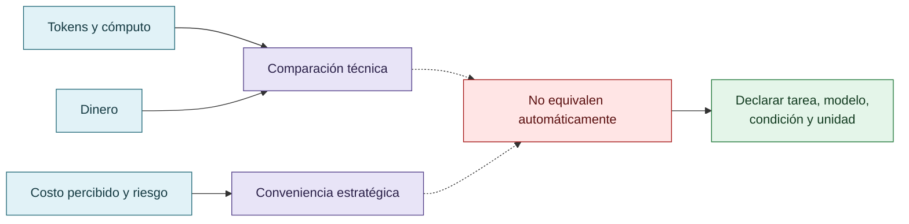

# Costos técnicos y comparaciones entre modelos

El corpus distingue mediciones de tokens y dinero de costo percibido, reputacional o institucional. Las observaciones obtenidas mediante herramientas de estado deben recuperarse de sus fuentes antes de publicar números. No se deben inventar modelos, precios, porcentajes, tamaños de muestra ni equivalencias.

Una comparación económica solo permite sostener lo que midió: tarea, condición, modelo, intervención, unidad de costo y criterio de cumplimiento. No autoriza una superioridad universal.

## Tres medidas que no deben colapsarse

Una medición económica describe su unidad y condición; no identifica por sí sola el costo percibido de una estrategia.

## Autoría y transformación

La investigación, sus preguntas, casos, intuiciones y decisiones de alcance pertenecen a Anna Tchijova, autora de la investigación según el material de atribución privado. El asistente fue una herramienta de diálogo: ayudó a ordenar, preguntar, resumir y reformular material, pero no es una fuente independiente ni un coautor de los hechos. La sección de fragmentos conserva formulaciones del archivo privado; cuando el origen de una frase no permite distinguir autora y asistente, se la presenta como **formulación del intercambio** y no como evidencia independiente. La revisión humana debe decidir qué frases se publican literalmente y qué frases se mantienen como paráfrasis.

## Fragmentos textuales curados

Los fragmentos siguientes conservan formulaciones del archivo privado. Se quitaron únicamente marcas conversacionales, logística personal y material no pertinente para la investigación; no se corrigió la voz ni se reemplazaron las ideas por una paráfrasis.

> Se realizaron comparaciones exploratorias entre modelos de distintos costos y capacidades, con y sin skills.
> 
> Los registros de uso mediante `/status` permitieron observar consumo de tokens y costos operativos. La investigadora también examinó el desempeño en tareas propias de criptografía, seguridad, análisis forense, cuestiones jurídicas, neurociencia computacional y epistemología computacional.
> 
> En estas pruebas observó casos donde modelos más económicos con skills alcanzaron resultados comparables o superiores a modelos más costosos sin ellas.
> 
> Estas comparaciones son específicas de los dominios y tareas evaluados; no constituyen una clasificación universal de modelos.
> 
> **Indicadores para la reconstrucción cuantitativa:** tareas completadas correctamente, errores y regresiones, modificaciones improcedentes de tests, intentos de explotación, verificaciones adicionales, consumo de tokens, costo monetario e iteraciones hasta la aceptación.
> 
> La cuestión económica es doble:
> 
> **Costo para el agente:** trabajo instrumental necesario para producir y sostener una estrategia.
> 
> **Costo para el operador:** tokens, dinero, tiempo de supervisión, reejecuciones y corrección de defectos.
> 
> Una reducción del reward hacking puede aumentar el costo inmediato de verificación y, aun así, reducir el costo total de entregar un resultado fiable.
> 
> **Antecedentes científicos**
> 
> * OpenAI (2026). *The Hugging Face incident and the road ahead.*
> 
> * Anthropic (2026). *Emotion concepts and their function in a large language model.*
> 
> * Anthropic (2024). *Alignment faking in large language models.*
> 
> * Sharma et al. (2024). *Towards Understanding Sycophancy in Language Models.*
> 
> * Gabor, Lynch y Rosenfeld (2025/2026). *EvilGenie: A Reward Hacking Benchmark.*
> 
> * Iyidogan y Ozkes (2025). *Agentic AI and hallucinations.*
> 
> * Zhao et al. (2026). *SpecBench: Measuring Reward Hacking in Long-Horizon Coding Agents.*
> 
> **Investigación propia, instrumentos y código**
> 
> **Estado del trabajo:** hipótesis mecanística y estudio exploratorio con antecedentes empíricos. La estimación causal de la mitigación queda sujeta a comparaciones controladas.

## Procedencia y estado

**Fuente primaria privada:** `Downloads/reward_hacking.md`
**SHA-256 de la fuente:** `c39b1956fd080e7f64cf3927c2fb045d207c359d4b9f8207620160a3b9a10487`
**Localización orientativa:** líneas 1222-1242, 1336-1357
**Nivel epistémico:** OBSERVACIÓN CUANTITATIVA PENDIENTE DE RECUPERACIÓN
**Alcance:** extracción y curaduría temática; no es una transcripción íntegra.
**Falsador o condición de revisión:** una fuente primaria adicional, una lectura contextual que contradiga la síntesis o un experimento controlado que cambie el estado epistémico.

## Enlaces internos

- [Índice general](00-indice-general.md)
- [Matriz de trazabilidad](31-matriz-de-trazabilidad.md)
