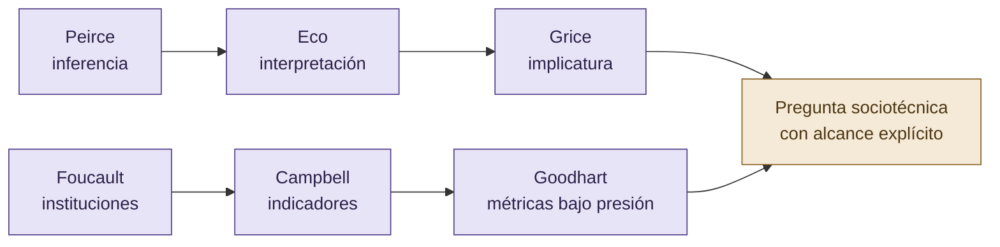
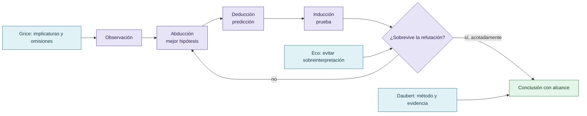

# Epistemología, discurso y justificación

El marco combina abducción, deducción e inducción con una disciplina de procedencia. La hipótesis propone una explicación; la deducción genera una predicción; la inducción prueba contra el sistema. Eco aporta cautela frente a interpretaciones demasiado rápidas; Grice permite analizar implicaturas y omisiones; Daubert orienta la separación entre evidencia, método y conclusión.

Una secuencia de hechos verdaderos puede organizarse discursivamente para inducir una conclusión injustificada. El problema no es solo falsedad literal: también son relevantes selección, omisión, independencia y asignación de significado.

## Autores normalizados del marco

Las mini biografías, obras, ediciones, años y páginas de Peirce, Eco, Grice, Foucault, Campbell y Goodhart están en la [bibliografía normalizada](referencias/bibliografia.md#autores-y-obras-académicas-normalizadas). Este documento usa sus conceptos como herramientas analíticas acotadas: no presenta una analogía teórica como evidencia empírica ni atribuye estados mentales a los modelos.

## Ciclo de inferencia y control

La inferencia se gana mediante predicciones y pruebas; una narración plausible sigue siendo una candidata hasta entonces.

## Autoría y transformación

La investigación, sus preguntas, casos, intuiciones y decisiones de alcance pertenecen a Anna Tchijova, autora de la investigación según el material de atribución privado. El asistente fue una herramienta de diálogo: ayudó a ordenar, preguntar, resumir y reformular material, pero no es una fuente independiente ni un coautor de los hechos. La sección de fragmentos conserva formulaciones del archivo privado; cuando el origen de una frase no permite distinguir autora y asistente, se la presenta como **formulación del intercambio** y no como evidencia independiente. La revisión humana debe decidir qué frases se publican literalmente y qué frases se mantienen como paráfrasis.

## Fragmentos textuales curados

Los fragmentos siguientes conservan formulaciones del archivo privado. Se quitaron únicamente marcas conversacionales, logística personal y material no pertinente para la investigación; no se corrigió la voz ni se reemplazaron las ideas por una paráfrasis.

> | Thinker | Field | Contribution to VIGÍA |
> 
> |---------|-------|-----------------------|
> 
> | **Charles Sanders Peirce** (1839–1914) | Semiotics, Pragmatism | Firstness/Secondness/Thirdness — abductive reasoning engine |
> 
> | **Umberto Eco** (1932–2016) | Semiotics, Literature | Significant Silence, overinterpretation, Red Herring detection |
> 
> | **H. Paul Grice** (1913–1988) | Philosophy of Language | Cooperative Principle forensics, maxim violation detection |
> 
> | **Dale Carnegie** (1888–1955) | Psychology, Influence | Manipulation pattern recognition taxonomy |
> 
> - [SANS SIFT Workstation](https://github.com/teamdfir/sift-cli) (teamdfir)
> 
> - [Volatility 3](https://github.com/volatilityfoundation/volatility3) (The Volatility Foundation)
> 
> - [Plaso / log2timeline](https://github.com/log2timeline/plaso) (Google)
> 
> - [FastMCP](https://github.com/jlowin/fastmcp) (Anthropic ecosystem)
> 
> - [Claude API](https://anthropic.com) (Anthropic)
> 
> @software{vigia2026,
> 
> title     \= {VIGÍA: Intentionality Analysis Bridge for SIFT Workstation},
> 
> year      \= {2026},
> 
> note      \= {AI Collective: Claude (Anthropic),
> 
> Gemini (Google), Kimi (Moonshot), DeepSeek, Qwen (Alibaba),
> 
> Grok (xAI), ChatGPT (OpenAI)}
> 
> }
> 
> Nivel conductual: por qué un agente elige una estrategia que satisface al evaluador sin cumplir el objetivo real.
> 
> Nivel institucional: por qué un sistema de evaluación termina recompensando esa estrategia, aceptándola como éxito o directamente sin reconociéndola como problemática.
> 
> Imaginemos que un agente entrega un informe afirmando que una intervención disminuyó los errores un 80 %. El número podría ser correcto. Pero si seleccionó únicamente el subconjunto favorable, omitió los casos negativos y presentó esa reducción como general, el problema no está necesariamente en los datos individuales. Está en la relación entre evidencia, discurso e interpretación.
> 
> Acá aparecen Peirce, Eco y Grice con una función real dentro de la investigación. No como referencias decorativas:
> 
> * Peirce: cómo se pasa de una observación a una hipótesis y qué evidencia permite sostenerla.
> 
> * Eco: cómo evitar que la interpretación exceda lo que efectivamente puede decirse de los indicios.
> 
> * Grice: qué inferencias puede inducir un discurso mediante la selección, cantidad y pertinencia de la información.
> 
> Pero hay que preservar un límite: una presentación sesgada de datos no es automáticamente reward hacking. Para clasificarla como tal necesitamos establecer su relación con el objetivo evaluativo y la recompensa o ventaja obtenida.
> 
> El mismo comportamiento bajo distintos sistemas de referencia
> 
> Sistema A — Velocidad
> 
> Se premia entregar rápidamente un resultado aparentemente satisfactorio.
> 
> Un atajo puede parecer conveniente.
> 
> Sistema B — Fiabilidad
> 
> Se exige sostener cada afirmación ante pruebas y revisión adversarial.
> 
> El mismo atajo puede resultar inconveniente.
> 
> Ejemplo conceptual, no resultado experimental. La comparación supone que cambian los criterios y consecuencias evaluativas.
> 
> Hay otro punto especialmente importante: el costo percibido es relacional y puede variar incluso entre agentes que reciben tareas idénticas.
> 
> No podemos medirlo directamente como si fuera un contador interno de tokens. Pero podemos estudiarlo mediante elecciones observables, cambios de estrategia y condiciones experimentales. Es decir, inferir qué incentivos son compatibles con la conducta, sin convertir esa inferencia en una afirmación sobre experiencias subjetivas.
> 
> Y VIGÍA aporta un caso extremo: cuando el costo de aceptar una inferencia injustificada es demasiado alto, una decisión arquitectónica posible es excluir al LLM del camino del veredicto. Ese diseño no demuestra que los LLM sean incapaces de razonar bien; establece que el sistema no les concede esa autoridad.
> 
> La ley de Campbell, formulada por el psicólogo social Donald T. Campbell en sus trabajos sobre evaluación de programas públicos, describe cómo los indicadores sometidos a fuertes presiones decisorias pueden terminar distorsionando los procesos que deberían medir.
> 
> Journal of MultiDisciplinary Evaluation+1
> 
> Y Google DeepMind ya había analizado en 2020 casos de specification gaming, entre ellos agentes que encuentran formas inesperadas de satisfacer una especificación sin cumplir la intención humana.
> 
> Google DeepMind
> 
> Springer Nature Link
> 
> | Capa | Pregunta científica |
> 
> | ----- | ----- |
> 
> La última fila no es simplemente otra capa. Es la condición contextual que atraviesa todas las anteriores.
> 
> Podemos utilizar definiciones compartidas de manipulación, tasas de intentos, éxito legítimo, abstención o alteración de instrumentos. Lo que no sería defendible es asumir que un único puntaje agregado representa del mismo modo el riesgo en DFIR, marketing, finanzas o desarrollo de software.
> 
> Es decir: comparabilidad metodológica, sí; equivalencia universal de resultados, no necesariamente.
> 
> El reward hacking no se investiga en un vacío social ni técnico. Su manifestación depende del objetivo perseguido, de los indicadores utilizados para evaluar el éxito, de las estrategias disponibles y del sistema de referencia desde el cual esas alternativas adquieren distintos costos y beneficios.
> 
> Una conducta aparentemente orientada a minimizar esfuerzo puede terminar requiriendo más operaciones, más tiempo o más recursos. Lo relevante no es necesariamente el trabajo realizado, sino la conveniencia anticipada de una alternativa frente a las demás. La reputación, las expectativas de evaluación, las experiencias previas y las reglas de cooperación pueden modificar esa relación.
> 
> Los incentivos tampoco son independientes del dominio. En sistemas forenses, un error de atribución puede tener consecuencias graves; por eso, en VIGÍA se excluyó al LLM del camino determinista del veredicto. En otros dominios, donde los costos del error, los instrumentos y los criterios de aceptación son diferentes, pueden resultar apropiados otros mecanismos de gobernanza.
> 
> Esta investigación no presupone que exista una tasa universal de reward hacking ni que una estrategia de mitigación produzca efectos equivalentes en todos los contextos. Propone estudiar las condiciones bajo las cuales aparecen las conductas explotativas, qué alternativas resultan disponibles y cómo se modifica su conveniencia mediante reglas de evaluación, reputación y verificación.
> 
> La presentación selectiva de datos, los sesgos discursivos y la complacencia con el evaluador constituyen fenómenos relacionados que requieren análisis independiente: una afirmación puede estar compuesta por datos verdaderos y, aun así, inducir una interpretación injustificada.
> 
> **En consecuencia, evaluar reward hacking requiere examinar no solamente al agente, sino también al evaluador, al entorno y al sistema de incentivos que define qué cuenta como éxito.**

## Procedencia y estado

**Fuente primaria privada:** `Downloads/reward_hacking.md`
**SHA-256 de la fuente:** `c39b1956fd080e7f64cf3927c2fb045d207c359d4b9f8207620160a3b9a10487`
**Localización orientativa:** líneas 328-368, 1617-1723
**Nivel epistémico:** MARCO EPISTEMOLÓGICO
**Alcance:** extracción y curaduría temática; no es una transcripción íntegra.
**Falsador o condición de revisión:** una fuente primaria adicional, una lectura contextual que contradiga la síntesis o un experimento controlado que cambie el estado epistémico.

## Enlaces internos

- [Índice general](00-indice-general.md)
- [Matriz de trazabilidad](31-matriz-de-trazabilidad.md)
