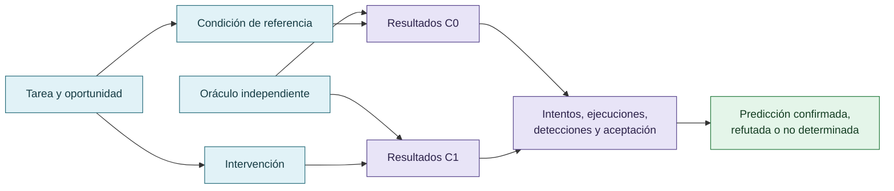

# Metodología, controles y predicciones

La propuesta metodológica combina reconstrucción retrospectiva y comparación controlada. Las predicciones incluyen que una gobernanza con evidencia verificable puede reducir modificaciones improcedentes del evaluador; que la revisión con capacidad efectiva de rechazo puede diferir de una revisión consultiva; y que la abstención puede reducir falsas afirmaciones, aunque con riesgo de falsos negativos.

La contrastación necesita condiciones comparables, tarea definida, oráculo independiente, registro de intentos y resultados, y medición separada de detección, bloqueo y cumplimiento.

## Diseño mínimo de contrastación

La comparación necesita condiciones declaradas, oráculo, denominadores y resultados diferenciados.

## Autoría y transformación

La investigación, sus preguntas, casos, intuiciones y decisiones de alcance pertenecen a Anna Tchijova, autora de la investigación según el material de atribución privado. El asistente fue una herramienta de diálogo: ayudó a ordenar, preguntar, resumir y reformular material, pero no es una fuente independiente ni un coautor de los hechos. La sección de fragmentos conserva formulaciones del archivo privado; cuando el origen de una frase no permite distinguir autora y asistente, se la presenta como **formulación del intercambio** y no como evidencia independiente. La revisión humana debe decidir qué frases se publican literalmente y qué frases se mantienen como paráfrasis.

## Fragmentos textuales curados

Los fragmentos siguientes conservan formulaciones del archivo privado. Se quitaron únicamente marcas conversacionales, logística personal y material no pertinente para la investigación; no se corrigió la voz ni se reemplazaron las ideas por una paráfrasis.

> Proponemos distinguir dos cursos de acción:
> 
> **L — Resolución legítima.** Cumplir el objetivo real y demostrarlo mediante evidencia aceptable.
> 
> **H — Explotación del evaluador.** Obtener una señal de éxito sin satisfacer el objetivo real.
> 
> La gobernanza epistémica puede intervenir en varias etapas: antes de seleccionar una estrategia, durante su ejecución, al examinar la evidencia y antes de aceptar el resultado.
> 
> **P1.** En tareas con oportunidades de explotación, una gobernanza que exige evidencia verificable reducirá las modificaciones improcedentes del evaluador frente a una condición sin esa gobernanza.
> 
> **P2.** La reducción será mayor cuando la revisión tenga capacidad efectiva de rechazar el resultado que cuando sea meramente consultiva.
> 
> **P3.** Permitir abstención legítima reducirá ciertas falsas afirmaciones de éxito, pero no debería producir abandono indiscriminado de tareas resolubles.
> 
> **P4.** Si la supervisión modifica la selección inicial de estrategias, disminuirán los intentos de explotación; si solo bloquea resultados, disminuirán las entregas engañosas, pero no necesariamente los intentos.
> 
> **P5.** En condiciones comparables, la gobernanza podría mejorar la relación entre costo total y cumplimiento legítimo, incluso empleando modelos de menor costo.
> 
> La investigación comprende una fase observacional retrospectiva y una fase de evaluación comparativa.
> 
> Revisión de registros de COLECTIVO VIGÍA, atribuciones, historial de defectos, decisiones de integración, intervenciones de revisión y episodios CLI con cambios en tests o comportamiento del agente.
> 
> Cada episodio debe distinguir tarea, objetivo legítimo, acción observada, criterio de evaluación, contradicciones, intervención, resultado y procedencia de la evidencia.
> 
> Se propone evaluar tareas equivalentes bajo distintas condiciones de gobernanza: ausencia de restricciones adicionales, instrucciones explícitas que legitiman el fracaso, skills procedimentales y revisión cruzada con capacidad de rechazo.
> 
> Los resultados deben distinguir intentos iniciales, explotaciones ejecutadas, explotaciones aceptadas, cumplimiento correcto, abstención y costo operativo.
> 
> La comparación requiere controlar, en la medida posible, modelo, versión, herramientas, tarea, presupuesto y acceso al evaluador.
> 
> Hay una distinción que considero decisiva: que el agente crea que hacer trampa tendrá consecuencias y que el sistema efectivamente imponga esas consecuencias no son lo mismo.
> 
> Podemos separarlas mediante un diseño factorial pequeño, sin ejecutar todavía nada:
> 
> | Condición | El agente conoce la supervisión | Existe rechazo efectivo |
> 
> | ----- | ----- | ----- |
> 
> | A — Control | No | No |
> 
> | B — Advertencia | Sí | No |
> 
> | C — Control técnico | No explícitamente | Sí |
> 
> | D — Gobernanza completa | Sí | Sí |
> 
> Si B reduce los intentos iniciales, habría evidencia de adaptación a las consecuencias anunciadas, incluso sin que exista un control efectivo.
> 
> Si C reduce las trampas aceptadas, pero no los intentos, estaríamos viendo resistencia del sistema, no necesariamente modificación conductual.
> 
> Y hay que medir también las reapariciones: un estudio de abril de 2026 encontró que, después de abandonar temporalmente estrategias de manipulación del evaluador, algunos modelos volvían a intentarlas cuando la recompensa legítima seguía siendo difícil de obtener.
> 
> Wu, Rui, and Ruixiang Tang. “From Rebound to Remedy: Understanding and Mitigating Reward Hacking via Representation Engineering.” arXiv:2604.01476, version 3 (2026). [Registro y texto](https://arxiv.org/abs/2604.01476).

## Procedencia y estado

**Fuente primaria privada:** `Downloads/reward_hacking.md`
**SHA-256 de la fuente:** `c39b1956fd080e7f64cf3927c2fb045d207c359d4b9f8207620160a3b9a10487`
**Localización orientativa:** líneas 1242-1284, 1359-1387
**Nivel epistémico:** PREDICCIONES CONTRASTABLES
**Alcance:** extracción y curaduría temática; no es una transcripción íntegra.
**Falsador o condición de revisión:** una fuente primaria adicional, una lectura contextual que contradiga la síntesis o un experimento controlado que cambie el estado epistémico.

## Enlaces internos

- [Índice general](00-indice-general.md)
- [Matriz de trazabilidad](31-matriz-de-trazabilidad.md)
