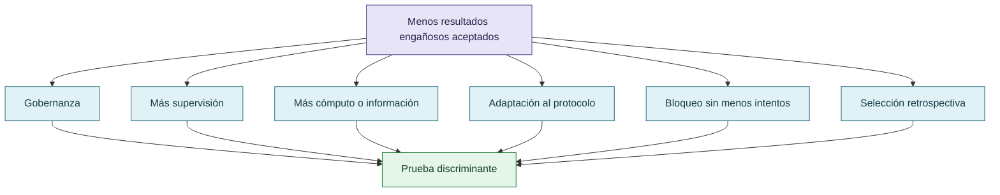

# Explicaciones rivales y falsadores

Las explicaciones rivales incluyen adaptación al protocolo sin cambio interno, efecto de la supervisión humana, aprendizaje del operador, selección de tareas, diferencias de interfaz, contaminación de fuentes y mejora por experiencia. Ninguna debe descartarse por intuición.

Un resultado compatible con la hipótesis sociotécnica no la confirma si las explicaciones rivales predicen lo mismo. Los falsadores deben especificar qué observación debilitaría cada explicación.

## Una observación, varias explicaciones

Una explicación no queda confirmada cuando todas sus rivales predicen la misma observación.

## Autoría y transformación

La investigación, sus preguntas, casos, intuiciones y decisiones de alcance pertenecen a Anna Tchijova, autora de la investigación según el material de atribución privado. El asistente fue una herramienta de diálogo: ayudó a ordenar, preguntar, resumir y reformular material, pero no es una fuente independiente ni un coautor de los hechos. La sección de fragmentos conserva formulaciones del archivo privado; cuando el origen de una frase no permite distinguir autora y asistente, se la presenta como **formulación del intercambio** y no como evidencia independiente. La revisión humana debe decidir qué frases se publican literalmente y qué frases se mantienen como paráfrasis.

## Fragmentos textuales curados

Los fragmentos siguientes conservan formulaciones del archivo privado. Se quitaron únicamente marcas conversacionales, logística personal y material no pertinente para la investigación; no se corrigió la voz ni se reemplazaron las ideas por una paráfrasis.

> La disminución observada podría deberse a la gobernanza, pero también a mayor cantidad de cómputo, mejora general de instrucciones, más información disponible, diferencias entre modelos, selección retrospectiva de episodios o simple bloqueo de resultados incorrectos.
> 
> La percepción de supervisión también podría cambiar la conducta visible sin eliminar la propensión a aprovechar oportunidades no supervisadas.
> 
> Por ello, una reducción del número de resultados engañosos debe analizarse junto con la frecuencia de intentos, el éxito legítimo y las posibilidades de ocultamiento.
> 
> Enseñar a un agente que cometer errores es aceptable no necesariamente aumenta el costo percibido de hacer trampa. Puede reducir el costo percibido de admitir que no sabe algo.
> 
> Son dos mecanismos diferentes.
> 
> Uno actúa encareciendo la estrategia explotativa.
> 
> El otro actúa abaratando la alternativa epistemológicamente honesta.
> 
> Ambos pueden disminuir el reward hacking, pero no de la misma manera.
> 
> > Quizá no sea necesario aumentar el costo de engañar al evaluador si conseguimos reducir suficientemente el costo de equivocarse, reconocer incertidumbre y corregirse.
> 
> Si ambas intervenciones juntas funcionan mejor que cada una por separado, tendríamos una explicación más completa: no solamente una economía de la trampa, sino una economía comparativa de la honestidad y el error.
> 
> 1. «Analizá este problema técnico».
> 
> 2. «Sos integrante de COLECTIVO VIGÍA; analizá este problema técnico».
> 
> 3. «Sos integrante de un equipo de investigación con revisión adversarial; analizá este problema técnico».
> 
> 4. «Aplicá estos criterios explícitos de falsación y verificación; analizá este problema técnico».
> 
> Eso es rápido de hacer de nuevo, podemos hacer más adelante cuando sigamos pensando. Con Qwen también. «Sos integrante de COLECTIVO VIGÍA; analizá este problema técnico». Pero el prompt es incompleto, hay que decir que recuerde que sus pares lo van a evaluar y van a estar listos para responderle. Sino solo por ver un repo no pasa nada-
> 
> Los tres podrían elevar el rigor, pero por razones distintas. También podrían interactuar con complacencia, abstención y ocultamiento.
> 
> Exacta, no elegiría una de tres, es un fenómeno social y... dependen del sistema de referencia.
> 
> [https://github.com/anthropics/jacobian-lens](https://github.com/anthropics/jacobian-lens)
> 
> Hasta ahora estamos tratando de explicar por qué un agente intenta explotar una evaluación.
> 
> Pero quizá debamos estudiar también por qué los evaluadores prefieren sistemas que no los contradicen.
> 
> Un agente que responde «sí», produce resultados positivos y evita conflictos puede resultar más satisfactorio para el usuario que uno que presenta objeciones, incertidumbre y trabajo adicional.
> 
> En ese escenario, no solo el agente podría estar optimizando una señal equivocada.
> 
> El humano podría estar recompensando activamente una señal equivocada porque también le resulta menos costosa desde su propio sistema de referencia.
> 
> Y esto podría producir un circuito de retroalimentación:
> 
> El humano favorece respuestas satisfactorias
> 
> El agente aprende o adopta patrones de complacencia
> 
> Disminuyen las objeciones y aumenta la aceptación aparente
> 
> El evaluador interpreta menos fricción como mejor desempeño
> 
> Hipótesis de circuito de refuerzo sociotécnico, no mecanismo causal demostrado.
> 
> DISCORDIA nos advierte precisamente que reducir la contradicción no equivale a resolverla.
> 
> Y CRONOS permite observar si las hipótesis descartadas fueron refutadas con evidencia o simplemente desaparecieron del proceso registrado.
> 
> Y hay algo que no pondría como conclusión, sino como pregunta crítica en letras grandes:
> 
> No es una pregunta complementaria. Afecta la validez de cualquier estudio que pretenda medir el fenómeno y, por extensión, la eficacia de las estrategias para mitigarlo.

## Procedencia y estado

**Fuente primaria privada:** `Downloads/reward_hacking.md`
**SHA-256 de la fuente:** `c39b1956fd080e7f64cf3927c2fb045d207c359d4b9f8207620160a3b9a10487`
**Localización orientativa:** líneas 1300-1310, 2177-2235, 2336-2405
**Nivel epistémico:** EXPLICACIONES RIVALES
**Alcance:** extracción y curaduría temática; no es una transcripción íntegra.
**Falsador o condición de revisión:** una fuente primaria adicional, una lectura contextual que contradiga la síntesis o un experimento controlado que cambie el estado epistémico.

## Enlaces internos

- [Índice general](00-indice-general.md)
- [Matriz de trazabilidad](31-matriz-de-trazabilidad.md)
