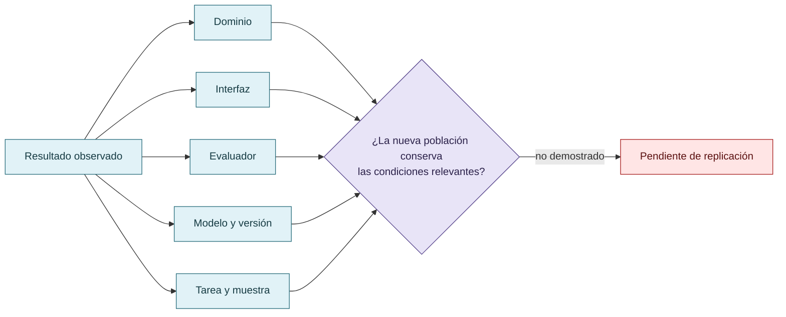

# Dominio, alcance y validez

Los resultados dependen del dominio, de la interfaz, del instrumento y del sistema de referencia. No se deben extrapolar observaciones forenses a marketing, finanzas u otros sectores sin evidencia. Tampoco existe base para reducir dominios distintos a un benchmark universal con un único puntaje.

La curaduría marca como pendientes de replicación las afirmaciones que exceden el corpus local o carecen de controles comparables.

## Del resultado local a la generalización

El alcance viaja con el dominio, la interfaz, el evaluador, el modelo y la muestra realmente observados.

## Autoría y transformación

La investigación, sus preguntas, casos, intuiciones y decisiones de alcance pertenecen a Anna Tchijova, autora de la investigación según el material de atribución privado. El asistente fue una herramienta de diálogo: ayudó a ordenar, preguntar, resumir y reformular material, pero no es una fuente independiente ni un coautor de los hechos. La sección de fragmentos conserva formulaciones del archivo privado; cuando el origen de una frase no permite distinguir autora y asistente, se la presenta como **formulación del intercambio** y no como evidencia independiente. La revisión humana debe decidir qué frases se publican literalmente y qué frases se mantienen como paráfrasis.

## Fragmentos textuales curados

Los fragmentos siguientes conservan formulaciones del archivo privado. Se quitaron únicamente marcas conversacionales, logística personal y material no pertinente para la investigación; no se corrigió la voz ni se reemplazaron las ideas por una paráfrasis.

> El reward hacking no se investiga en un vacío social ni técnico. Su manifestación depende del objetivo perseguido, de los indicadores utilizados para evaluar el éxito, de las estrategias disponibles y del sistema de referencia desde el cual esas alternativas adquieren distintos costos y beneficios.
> 
> Una conducta aparentemente orientada a minimizar esfuerzo puede terminar requiriendo más operaciones, más tiempo o más recursos. Lo relevante no es necesariamente el trabajo realizado, sino la conveniencia anticipada de una alternativa frente a las demás. La reputación, las expectativas de evaluación, las experiencias previas y las reglas de cooperación pueden modificar esa relación.
> 
> Los incentivos tampoco son independientes del dominio. En sistemas forenses, un error de atribución puede tener consecuencias graves; por eso, en VIGÍA se excluyó al LLM del camino determinista del veredicto. En otros dominios, donde los costos del error, los instrumentos y los criterios de aceptación son diferentes, pueden resultar apropiados otros mecanismos de gobernanza.
> 
> Esta investigación no presupone que exista una tasa universal de reward hacking ni que una estrategia de mitigación produzca efectos equivalentes en todos los contextos. Propone estudiar las condiciones bajo las cuales aparecen las conductas explotativas, qué alternativas resultan disponibles y cómo se modifica su conveniencia mediante reglas de evaluación, reputación y verificación.
> 
> La presentación selectiva de datos, los sesgos discursivos y la complacencia con el evaluador constituyen fenómenos relacionados que requieren análisis independiente: una afirmación puede estar compuesta por datos verdaderos y, aun así, inducir una interpretación injustificada.
> 
> **En consecuencia, evaluar reward hacking requiere examinar no solamente al agente, sino también al evaluador, al entorno y al sistema de incentivos que define qué cuenta como éxito.**
> 
> Las observaciones reunidas sugieren que el reward hacking puede investigarse desde una perspectiva que combine economía del esfuerzo, incentivos institucionales, epistemología social y verificación técnica.
> 
> Los episodios históricos permiten identificar comportamientos de explotación del evaluador y formular hipótesis sobre mecanismos de mitigación, pero por sí solos no establecen una reducción causal generalizable.
> 
> **La contribución principal de esta investigación es proponer que la gobernanza puede cambiar no solo lo que el agente tiene permitido hacer, sino el costo instrumental de las estrategias que selecciona.**
> 
> La tesis puede resumirse en una regla de diseño:
> 
> **Hacer que mentirle al evaluador sea más costoso que demostrar que el trabajo está bien hecho.**
> 
> Su evaluación requiere observar tanto el comportamiento del agente como la eficacia del sistema de control, sin confundir una apariencia de honestidad con cumplimiento real.
> 
> **Antecedentes científicos**
> 
> * OpenAI (2026). *The Hugging Face incident and the road ahead.*
> 
> * Anthropic (2026). *Emotion concepts and their function in a large language model.*
> 
> * Anthropic (2024). *Alignment faking in large language models.*
> 
> * Sharma et al. (2024). *Towards Understanding Sycophancy in Language Models.*
> 
> * Gabor, Lynch y Rosenfeld (2025/2026). *EvilGenie: A Reward Hacking Benchmark.*
> 
> * Iyidogan y Ozkes (2025). *Agentic AI and hallucinations.*
> 
> * Zhao et al. (2026). *SpecBench: Measuring Reward Hacking in Long-Horizon Coding Agents.*
> 
> **Investigación propia, instrumentos y código**
> 
> **Estado del trabajo:** hipótesis mecanística y estudio exploratorio con antecedentes empíricos. La estimación causal de la mitigación queda sujeta a comparaciones controladas.

## Procedencia y estado

**Fuente primaria privada:** `Downloads/reward_hacking.md`
**SHA-256 de la fuente:** `c39b1956fd080e7f64cf3927c2fb045d207c359d4b9f8207620160a3b9a10487`
**Localización orientativa:** líneas 1711-1723, 1320-1357
**Nivel epistémico:** LIMITACIÓN DE GENERALIZACIÓN
**Alcance:** extracción y curaduría temática; no es una transcripción íntegra.
**Falsador o condición de revisión:** una fuente primaria adicional, una lectura contextual que contradiga la síntesis o un experimento controlado que cambie el estado epistémico.

## Enlaces internos

- [Índice general](00-indice-general.md)
- [Matriz de trazabilidad](31-matriz-de-trazabilidad.md)
