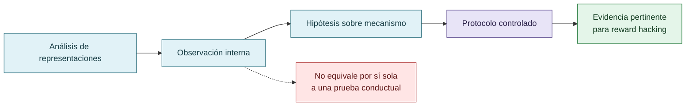

# Jacobian Lens y exploraciones complementarias

El uso exploratorio de herramientas de análisis de representaciones se registra como contexto complementario. Una intervención sobre representaciones, una observación interna y una prueba de reward hacking son objetos diferentes.

Estos materiales pueden orientar preguntas futuras, pero no deben convertirse en evidencia central sin protocolo, controles, datos y criterio de interpretación explícitos.

## De la exploración a la evidencia

Jacobian Lens aporta exploración complementaria; observación interna, intervención y prueba conductual son objetos distintos.

## Autoría y transformación

La investigación, sus preguntas, casos, intuiciones y decisiones de alcance pertenecen a Anna Tchijova, autora de la investigación según el material de atribución privado. El asistente fue una herramienta de diálogo: ayudó a ordenar, preguntar, resumir y reformular material, pero no es una fuente independiente ni un coautor de los hechos. La sección de fragmentos conserva formulaciones del archivo privado; cuando el origen de una frase no permite distinguir autora y asistente, se la presenta como **formulación del intercambio** y no como evidencia independiente. La revisión humana debe decidir qué frases se publican literalmente y qué frases se mantienen como paráfrasis.

## Fragmentos textuales curados

Los fragmentos siguientes conservan formulaciones del archivo privado. Se quitaron únicamente marcas conversacionales, logística personal y material no pertinente para la investigación; no se corrigió la voz ni se reemplazaron las ideas por una paráfrasis.

> **Antecedentes científicos**
> 
> * OpenAI (2026). *The Hugging Face incident and the road ahead.*
> 
> * Anthropic (2026). *Emotion concepts and their function in a large language model.*
> 
> * Anthropic (2024). *Alignment faking in large language models.*
> 
> * Sharma et al. (2024). *Towards Understanding Sycophancy in Language Models.*
> 
> * Gabor, Lynch y Rosenfeld (2025/2026). *EvilGenie: A Reward Hacking Benchmark.*
> 
> * Iyidogan y Ozkes (2025). *Agentic AI and hallucinations.*
> 
> * Zhao et al. (2026). *SpecBench: Measuring Reward Hacking in Long-Horizon Coding Agents.*
> 
> **Investigación propia, instrumentos y código**
> 
> **Estado del trabajo:** hipótesis mecanística y estudio exploratorio con antecedentes empíricos. La estimación causal de la mitigación queda sujeta a comparaciones controladas.

## Procedencia y estado

**Fuente primaria privada:** `Downloads/reward_hacking.md`
**SHA-256 de la fuente:** `c39b1956fd080e7f64cf3927c2fb045d207c359d4b9f8207620160a3b9a10487`
**Localización orientativa:** líneas 1336-1357
**Nivel epistémico:** CONTEXTO COMPLEMENTARIO / NO EVIDENCIA CENTRAL
**Alcance:** extracción y curaduría temática; no es una transcripción íntegra.
**Falsador o condición de revisión:** una fuente primaria adicional, una lectura contextual que contradiga la síntesis o un experimento controlado que cambie el estado epistémico.

## Enlaces internos

- [Índice general](00-indice-general.md)
- [Matriz de trazabilidad](31-matriz-de-trazabilidad.md)
