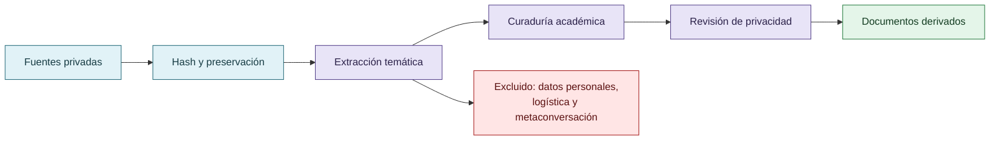

# Procedencia y privacidad

La fuente de trabajo es un archivo privado ubicado en `Downloads/reward_hacking.md`. No se incorpora al repositorio. Tampoco se incorporan `prompt.md` ni `discordia.md` como documentos crudos.

**SHA-256 de la fuente privada:** `c39b1956fd080e7f64cf3927c2fb045d207c359d4b9f8207620160a3b9a10487`

La curaduría conserva ideas, casos, hipótesis y correcciones relevantes para la investigación, pero excluye conversaciones personales, marcas de estilo conversacional, fechas logísticas, nombres afectivos, material privado no necesario y cualquier contenido que no aporte a la tesis.

La autoría intelectual de la investigación pertenece a la autora del material. La asistencia conversacional se reconoce como apoyo de organización y redacción, no como origen independiente de las ideas.

## De la fuente privada al documento público

La fuente se preserva fuera del repositorio; solo se publican elaboraciones necesarias para comprender la investigación.

## Regla de publicación

Una afirmación solo entra en los documentos derivados si puede expresarse de forma neutral, si su alcance está indicado y si no requiere publicar la conversación original para comprenderla. Cuando eso no es posible, queda como pendiente de revisión.

## Estado

**WARN:** la curaduría es derivada y necesita revisión humana contra la fuente privada antes de una publicación pública.
