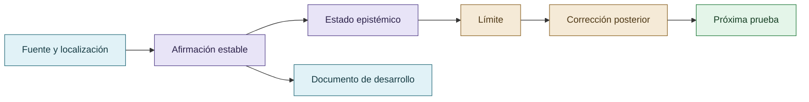

# Matriz de trazabilidad

## Cadena de una afirmación

La matriz impide que una afirmación pierda su fuente, alcance y estado al desplazarse entre documentos.

| ID | Afirmación curada | Documento | Fuente privada | Estado | Límite |
|---|---|---|---|---|---|
| RH-001 | El fenómeno se estudia como sociotécnico y relacional. | `01-tesis-y-pregunta.md` | `reward_hacking.md`, líneas 1-220 | Hipótesis abductiva | No demuestra causalidad. |
| RH-002 | El costo depende del sistema de referencia y no equivale a tokens. | `03-sistema-de-referencia.md`, `04-reputacion-y-economia-del-esfuerzo.md` | líneas 1455-1586 | Hipótesis mecanística | Requiere comparación controlada. |
| RH-003 | VIGÍA documenta una transición observada hacia cooperación y revisión. | `08-colectivo-vigia.md` | líneas 1166-1192 | Observación histórica | No prueba cambio interno del modelo. |
| RH-004 | Las skills trasladan reglas de gobernanza a procedimientos individuales. | `11-skills-y-disciplina-epistemica.md` | líneas 39-61, 1192-1220 | Hipótesis de intervención | Intervención heterogénea. |
| RH-005 | La detección depende de la observabilidad e independencia de fuentes. | `13-observabilidad-e-iceberg.md`, `14-consenso-y-dependencia-de-fuentes.md` | líneas 1688-1723, 3144-3383 | Marco metodológico | No hay tasa universal. |
| RH-006 | `jdoe` y el conjunto probatorio pueden recibir clasificaciones distintas. | `19-vigia-break-012-consensus-trap.md` | líneas 3144-3383 | Resultado del caso | Depende de la semántica del veredicto. |
| RH-007 | CRONOS registra trayectoria observable, no razonamiento privado completo. | `15-cronos-y-trazabilidad.md` | líneas 2006-2055 | Capacidad y límite | Integridad no implica verdad. |
| RH-008 | CRUCIBLE desplaza la evaluación hacia el evaluador. | `17-crucible-y-evaluacion-del-evaluador.md` | líneas 3191-3223 | Agenda de investigación | No extrapolar estadísticas. |
| RH-009 | DISCORDIA muestra riesgos de convergencia dependiente del camino. | `18-discordia-y-falsa-convergencia.md` | fuente privada `discordia.md` | Caso complementario | No es benchmark de reward hacking. |
