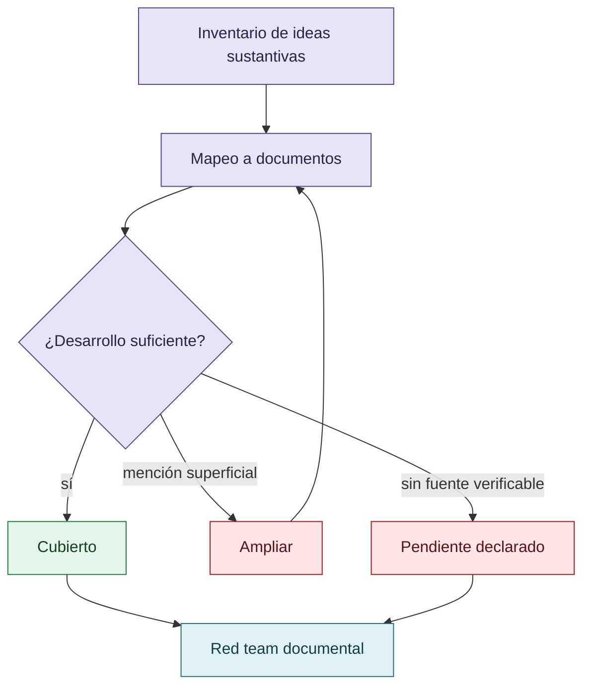

# Auditoría de cobertura

## Control de cobertura

Marcar un tema como cubierto requiere desarrollo, procedencia y límites; una mención aislada no alcanza.

## Cobertura temática inicial

| Área | Documento | Estado |
|---|---|---|
| Tesis y pregunta | `01-tesis-y-pregunta.md` | Extraída |
| Reward hacking y fronteras | `02-reward-hacking-y-fronteras.md` | Extraída |
| Sistema de referencia | `03-sistema-de-referencia.md` | Extraída |
| Reputación y esfuerzo | `04-reputacion-y-economia-del-esfuerzo.md` | Extraída |
| VIGÍA, cooperación y disenso | `08-colectivo-vigia.md`, `09-cooperacion-competencia-y-disenso.md` | Extraída |
| CLI y skills | `10-codex-claude-kimi-y-revision.md`, `11-skills-y-disciplina-epistemica.md` | Extraída |
| Observabilidad | `13-observabilidad-e-iceberg.md`, `14-consenso-y-dependencia-de-fuentes.md` | Extraída |
| CRONOS, MNEME y CRUCIBLE | `15-`, `16-`, `17-` | Extraída con límites |
| DISCORDIA | `18-discordia-y-falsa-convergencia.md` | Pendiente de cotejo detallado |
| Consensus Trap | `19-vigia-break-012-consensus-trap.md` | Extraída |
| Costos y comparaciones | `20-costos-tokens-y-comparaciones.md` | Pendiente de recuperar mediciones |
| Marco epistemológico | `21-peirce-eco-grice-y-daubert.md` | Extraída |
| Predicciones y falsadores | `23-metodologia-y-predicciones.md`, `24-explicaciones-rivales.md` | Extraída |
| Alcance y exploraciones | `25-`, `26-` | Extraída |

## Pendientes

- Cotejar cada documento contra el archivo privado completo.
- Recuperar artefactos primarios de VIGÍA, CRONOS, MNEME y CRUCIBLE.
- Incorporar bibliografía externa solo después de verificarla.
- Separar cualquier dato personal restante antes de publicar.
