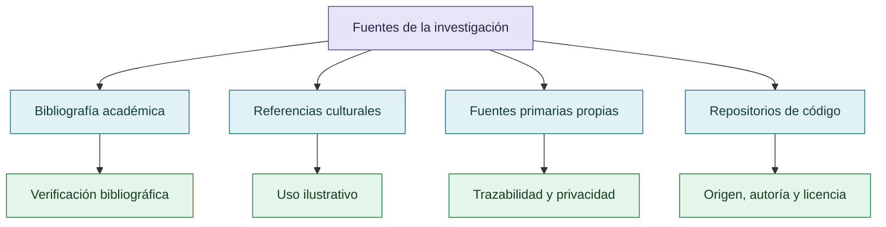

# Fuentes y referencias

## Taxonomía de fuentes

Cada tipo de fuente cumple una función distinta y no debe prestar autoridad a otro tipo de afirmación.

## Fuente primaria privada

- `Downloads/reward_hacking.md` — fuente de la extracción temática; no se publica en este repositorio.

## Inventarios navegables

- [Bibliografía](referencias/bibliografia.md)
- [Repositorios y forks](referencias/repositorios.md)
- [Fuentes primarias y artefactos](referencias/fuentes-primarias.md)

## Fuentes mencionadas que requieren verificación

- Repositorios de VIGÍA, CRONOS, MNEME, DISCORDIA y CRUCIBLE.
- Documentación de herramientas y experimentos citados en el corpus.
- Literatura sobre reward hacking, specification gaming, Goodhart, evaluación, abducción y epistemología social.

## Regla

No se agregan autores, DOI, fechas, resultados ni URLs como hechos hasta verificar la fuente correspondiente. Las referencias culturales se mantienen separadas de la bibliografía académica.
