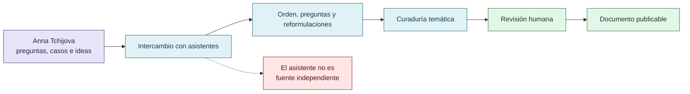

# Autoría y método de curaduría

## Autoría y transformación

La asistencia editorial se reconoce sin desplazar la autoría intelectual ni convertir reformulaciones en evidencia externa.

## Autoría

La idea de investigar reward hacking como fenómeno sociotécnico, las preguntas, las experiencias documentadas, los casos, las objeciones y las decisiones de alcance pertenecen a Anna Tchijova, autora de la investigación según el material de atribución privado. El asistente participó como instrumento de conversación y edición: ayudó a extraer, comparar, ordenar, detectar contradicciones y proponer formulaciones.

Una reformulación del asistente no se convierte por eso en una fuente externa ni en una prueba. Cuando una frase proviene del intercambio y no es posible atribuirla con seguridad, se conserva como **formulación del intercambio** y queda sujeta a revisión humana.

## Método

1. Se leyó el archivo privado `Downloads/reward_hacking.md` sin copiarlo al repositorio.
2. Se separaron categorías temáticas, casos, hipótesis, métodos, límites y preguntas abiertas.
3. Se conservaron fragmentos textuales seleccionados, retirando logística, datos personales y metaconversación que no aporta a la investigación.
4. Cada documento declara procedencia, nivel epistémico y condición de falsación.
5. Se revisaron los documentos generados en conjunto para retirar residuos conversacionales identificables.

## Qué no afirma este repositorio

- No afirma que cada fragmento textual haya sido escrito originalmente por la autora.
- No presenta al asistente como investigador independiente.
- No publica `prompt.md`, `reward_hacking.md` ni `discordia.md` como documentos crudos.
- No convierte una hipótesis, un relato retrospectivo o una referencia cultural en resultado experimental.
