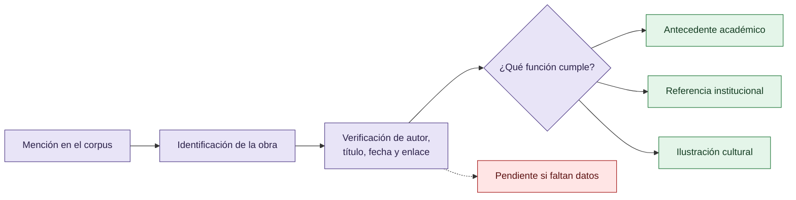

# Bibliografía de trabajo

Esta lista separa literatura y referencias externas del material privado. Las entradas están enlazadas cuando se pudo identificar una página estable. El estado indica si la referencia fue confirmada como fuente primaria o si todavía requiere cotejo bibliográfico.

## Ingreso de una referencia

Una referencia entra con su función y estado de verificación; no se completan datos bibliográficos por conjetura.

## Reward hacking, especificación y evaluación

- [DeepMind: Specification gaming: the flip side of AI ingenuity](https://deepmind.google/discover/blog/specification-gaming-the-flip-side-of-ai-ingenuity/) — referencia primaria institucional para specification gaming; cotejar fecha y alcance antes de citar resultados.
- [Anthropic: Alignment faking in large language models](https://www.anthropic.com/research/alignment-faking) — referencia primaria institucional sobre alignment faking; no equivale automáticamente a reward hacking.
- [OpenAI: Evaluating chain-of-thought monitorability](https://openai.com/index/chain-of-thought-monitoring/) — referencia institucional para problemas de evaluación y monitorización; separar del argumento central del corpus.

## Leyes, criterios y epistemología

- [Goodhart's law, GOV.UK](https://www.gov.uk/government/publications/the-magenta-book/review-of-the-magenta-book) — referencia institucional para la advertencia sobre métricas; la formulación histórica debe cotejarse con Campbell y Goodhart.
- [Daubert v. Merrell Dow Pharmaceuticals, Inc., 509 U.S. 579](https://supreme.justia.com/cases/federal/us/509/579/) — referencia jurídica pública para criterios de admisibilidad; no es un método científico general.
- [Stanford Encyclopedia of Philosophy: Abduction](https://plato.stanford.edu/entries/abduction/) — referencia secundaria académica para abducción.

## Referencias culturales separadas

- [Dale Carnegie, How to Win Friends and Influence People](https://www.dalecarnegie.com/en/books/how-to-win-friends-and-influence-people) — referencia cultural, no evidencia experimental.
- [Jaime Altozano — Trap del Terraplanismo (2018)](https://www.youtube.com/watch?v=ziJuNQcJn24) — ilustración cultural incluida en el corpus; no es evidencia experimental.
- [OpenAI — The Hugging Face incident and the road ahead](https://openai.com/index/hugging-face-incident-and-the-road-ahead/) — referencia institucional mencionada en el corpus; cotejar versión y fecha.
- [Anthropic — Towards Understanding Sycophancy](https://www.anthropic.com/research/towards-understanding-sycophancy-in-language-models) — referencia institucional mencionada en el corpus.
- [Anthropic — Alignment Faking in Large Language Models](https://www.anthropic.com/research/alignment-faking) — referencia institucional mencionada en el corpus.
- [Anthropic — Investigating Unintended Model Actions](https://www.anthropic.com/research/investigating-unintended-model-actions) — referencia institucional mencionada en el corpus; cotejar versión y fecha.

## Autores y obras académicas normalizadas

Esta sección fija, para esta versión del corpus, una edición concreta por autor. Las páginas corresponden a esa edición y no deben trasladarse automáticamente a otra traducción, reimpresión o versión digital. Si la autora decide cambiar de edición, debe reemplazar la entrada completa y volver a verificar cada página. No se completan campos bibliográficos por conjetura.

### Charles Sanders Peirce (1839–1914)

**Mini bio.** Filósofo, lógico, matemático y científico estadounidense; fundador del pragmatismo y una figura central en la teoría de los signos, la lógica de la investigación y la comunicación. La [Stanford Encyclopedia of Philosophy](https://plato.stanford.edu/entries/peirce/) documenta ese perfil y su trayectoria intelectual.

**Obra utilizada.** Peirce, Charles Sanders. “Abduction and Induction.” En Justus Buchler (ed.), *Philosophical Writings of Peirce*, pp. 150–156. New York: Dover Publications, 1955.

**Uso en este corpus.** Abducción, inducción y relación entre hipótesis y evidencia. Esta cita se refiere a la edición de Buchler de 1955; no debe confundirse con una paginación de *The Essential Peirce*.

### Umberto Eco (1932–2016)

**Mini bio.** Semiólogo, escritor, crítico literario, medievalista y profesor italiano; fue profesor de semiótica en la Universidad de Bolonia. La [Università di Bologna](https://www.unibo.it/en/university/who-we-are/our-history/famous-people-and-students/umberto-eco-1) resume su trayectoria académica y sus campos de trabajo.

**Obra utilizada.** Eco, Umberto. “Interpretation and History.” En Stefan Collini (ed.), *Interpretation and Overinterpretation*, pp. 23–44. Cambridge: Cambridge University Press, 1992. [Ficha del capítulo](https://www.cambridge.org/core/books/abs/interpretation-and-overinterpretation/interpretation-and-history/5E8A3A41657BF43F913C1CA2543FA196).

**Uso en este corpus.** Límites de la interpretación y cautela frente a la sobreinterpretación de indicios. La referencia es al capítulo de la edición de 1992, no a una traducción posterior.

### H. Paul Grice (1913–1988)

**Mini bio.** Filósofo británico de la tradición analítica, conocido por sus trabajos sobre significado, implicatura conversacional y cooperación comunicativa. La [Stanford Encyclopedia of Philosophy](https://plato.stanford.edu/entries/grice/) desarrolla esas contribuciones.

**Obra utilizada.** Grice, H. Paul. “Logic and Conversation.” En P. Cole y J. L. Morgan (eds.), *Syntax and Semantics, vol. 3: Speech Acts*, pp. 41–58. New York: Academic Press, 1975. [Registro del capítulo](https://doi.org/10.1163/9789004368811_003).

**Uso en este corpus.** Implicaturas, cantidad, pertinencia y omisiones comunicativamente relevantes. La paginación corresponde al capítulo publicado en 1975.

### Michel Foucault (1926–1984)

**Mini bio.** Filósofo e historiador de las ideas francés; sus análisis de poder, disciplina, vigilancia, saber e instituciones son utilizados aquí como marco institucional acotado, no como analogía de estados mentales de un modelo. La [Stanford Encyclopedia of Philosophy](https://plato.stanford.edu/entries/foucault/) ofrece una introducción académica a su obra.

**Obra utilizada.** Foucault, Michel. “Panopticism.” En *Discipline and Punish: The Birth of the Prison*, traducción de Alan Sheridan, 2nd Vintage Books ed., pp. 195–228. New York: Vintage Books, 1995. [Texto de la edición consultada](https://files.libcom.org/files/michel-foucault-panopticism.pdf). Obra original en francés: 1975; traducción inglesa: 1977.

**Uso en este corpus.** Visibilidad, vigilancia, disciplina y organización institucional de la evaluación. Las páginas indicadas son las de la segunda edición de Vintage Books de 1995.

### Donald Thomas Campbell (1916–1996)

**Mini bio.** Psicólogo y científico social estadounidense, reconocido por sus trabajos sobre evaluación, cambio social planificado y epistemología evolucionista. La obra citada pertenece a su investigación sobre evaluación de intervenciones, no es una formulación automática de reward hacking.

**Obra utilizada.** Campbell, Donald Thomas. “Assessing the Impact of Planned Social Change.” *Evaluation and Program Planning* 2(1) (1979): 67–90. [Registro editorial y DOI](https://doi.org/10.1016/0149-7189(79)90048-X).

**Uso en este corpus.** Ley de Campbell y presión sobre indicadores. La referencia normalizada aquí es el artículo de revista de 1979, pp. 67–90. Existe una versión anterior como *Occasional Paper Series No. 8* (Evaluation Center, Western Michigan University, 1976); no se asigna una página de esa versión a una cita del artículo de 1979.

### Charles A. E. Goodhart (1936–)

**Mini bio.** Economista británico, profesor emérito de la London School of Economics y exasesor del Banco de Inglaterra; sus trabajos vinculan teoría monetaria, política económica e indicadores. La [London School of Economics](https://www.fmg.ac.uk/people/charles-goodhart) documenta su trayectoria institucional.

**Obra utilizada.** Goodhart, Charles A. E. “Problems of Monetary Management: The U.K. Experience.” En *Monetary Theory and Practice: The U.K. Experience*, 1st ed., pp. 91–121. London: Macmillan, 1979. [Ficha editorial de la edición](https://link.springer.com/book/10.1007/978-1-349-17295-5).

**Uso en este corpus.** Goodhart’s law y la pérdida de estabilidad de una regularidad cuando se la convierte en objetivo de control. Para la formulación citada, usar p. 116 de la paginación del capítulo de esta versión; no mezclarla con p. 96 de reimpresiones posteriores ni con la versión de 1975.

## Regla de citación para el corpus

Toda cita textual de estos seis autores debe conservar autor, título del capítulo o artículo, edición o publicación utilizada, año y página o rango de páginas. Una paráfrasis debe marcarse como paráfrasis. Si una fuente digital no conserva la paginación de la edición indicada, la cita queda en estado **WARN** hasta cotejarla con un ejemplar paginado. Las bios son contexto editorial y no sustituyen la cita de la obra.

## Inventario exhaustivo de enlaces del material de trabajo

Este inventario se construyó recorriendo los enlaces de `Downloads/prompt.md`, `Downloads/reward_hacking.md` y los archivos de `Downloads/investigathon`. Se conservaron todos los destinos identificables; se quitaron barras finales duplicadas, parámetros de tracking (`utm_*`, `request_id`, `biz_id`, `trk`, `ops_request_misc`, etc.) y URLs identificadas como errores tipográficos.

### Enlaces del documento inicial y del corpus principal

- `prompt.md`: [SKILLS](https://github.com/annatchijova/SKILLS), [CRONOS](https://github.com/annatchijova/cronos), [DISCORDIA](https://github.com/annatchijova/discordia), [MNEME](https://github.com/annatchijova/mneme), [VIGÍA](https://github.com/annatchijova/vigia-intent-analysis) y [Jacobian Lens](https://github.com/anthropics/jacobian-lens).
- `reward_hacking.md`: [arXiv:2604.01476](https://arxiv.org/abs/2604.01476), [Claude share](https://claude.ai/share/e15d57f1-57b4-445d-950d-9cedc310dd43), [DeepMind — Specification gaming](https://deepmind.google/blog/specification-gaming-the-flip-side-of-ai-ingenuity/), [SKILLS — red-team-auditing](https://github.com/annatchijova/SKILLS/blob/main/red-team-auditing/SKILL.md), [CRONOS](https://github.com/annatchijova/cronos), [DISCORDIA](https://github.com/annatchijova/discordia), [DISCORDIA — design rationale](https://github.com/annatchijova/discordia/blob/main/DESIGN_RATIONALE.md), [MNEME](https://github.com/annatchijova/mneme/), [VIGÍA](https://github.com/annatchijova/vigia-intent-analysis/), [VIGIA-BREAK-012](https://github.com/annatchijova/vigia-intent-analysis/blob/main/evidence/VIGIA-BREAK-012.json), [Jacobian Lens](https://github.com/anthropics/jacobian-lens), [Journal of MultiDisciplinary Evaluation](https://jmde.journals.publicknowledgeproject.org/index.php/jmde_1/article/view/297), [Springer](https://link.springer.com/article/10.1007/s44163-026-01980-z), [OpenAI — Hugging Face incident, English](https://openai.com/index/hugging-face-incident-and-the-road-ahead/), [OpenAI — Hugging Face incident, Spanish](https://openai.com/es-419/index/hugging-face-incident-and-the-road-ahead/), [Anthropic — Alignment faking](https://www.anthropic.com/research/alignment-faking), [Anthropic — Emotion concepts](https://www.anthropic.com/research/emotion-concepts-function), [Anthropic — Global workspace](https://www.anthropic.com/research/global-workspace), [Anthropic — Unintended model actions](https://www.anthropic.com/research/investigating-unintended-model-actions), [Anthropic — Sycophancy](https://www.anthropic.com/research/towards-understanding-sycophancy-in-language-models), [Anthropic — Transparency](https://www.anthropic.com/transparency), [Fotech — divulgación científica](https://www.fotech.cl/la-ciencia-contraataca-la-nueva-difusion-cientifica/2018/08/20/), [Foucault.info — Panopticism](https://www.foucault.info/documents/foucault.disciplineAndPunish.panOpticism/), [ScienceDirect — article 0749597885900494](https://www.sciencedirect.com/science/article/abs/pii/0749597885900494), [ScienceDirect — article S016517652500357X](https://www.sciencedirect.com/science/article/pii/S016517652500357X), [Trap del Terraplanismo](https://www.youtube.com/watch?v=ziJuNQcJn24).

### Fuentes nuevas aportadas desde `investigathon`

Estas URLs son los orígenes declarados por los archivos encontrados en `Downloads/investigathon`. Se incluyen como fuentes de contexto y requieren evaluación de autoría, traducción, fecha y calidad antes de sostener una afirmación académica.

- `БАСНЯ №5.md`: [Habr — БАСНЯ №5](https://habr.com/ru/articles/1046926/).
- `Поразительная креативность цифровой эволюции.md`: [Habr — The Surprising Creativity of Digital Evolution](https://habr.com/ru/articles/438302/).
- `Селективная генерализация: улучшение возможностей при сохранении alignment.md`: [Habr — Selective generalization](https://habr.com/ru/articles/945838/).
- `Эффект наблюдателя.md`: [Habr — Observer effect](https://habr.com/ru/articles/118729/), [métricas en Agile](http://lib.custis.ru/Метрики_в_Agile_%28встреча_AgileRussia.ru_2009-08-18), [consultoría de evaluación de desempeño](http://local.joelonsoftware.com/wiki/Консалтинг_по_оценке_производительности_%28из_писем).
- `chinos2.md`: [CSDN — Goodhart's law](https://blog.csdn.net/vviccc/article/details/149860872), [CSDN — artículo relacionado](https://blog.csdn.net/m0_37586991/article/details/151262356), [CSDN — artículo relacionado](https://blog.csdn.net/weixin_28487433/article/details/168049589), [CSDN — artículo relacionado](https://blog.csdn.net/weixin_41808082/article/details/117065140), [CSDN — artículo relacionado](https://blog.csdn.net/weixin_42588877/article/details/168329236), [TaoToken](https://taotoken.net).

Los documentos `chinos.md` y `chinos2.md` contienen material largo de agregación o republicación. El inventario registra sus orígenes identificables, pero no convierte automáticamente cada enlace incrustado en una fuente validada ni incorpora esos textos crudos al repositorio.
