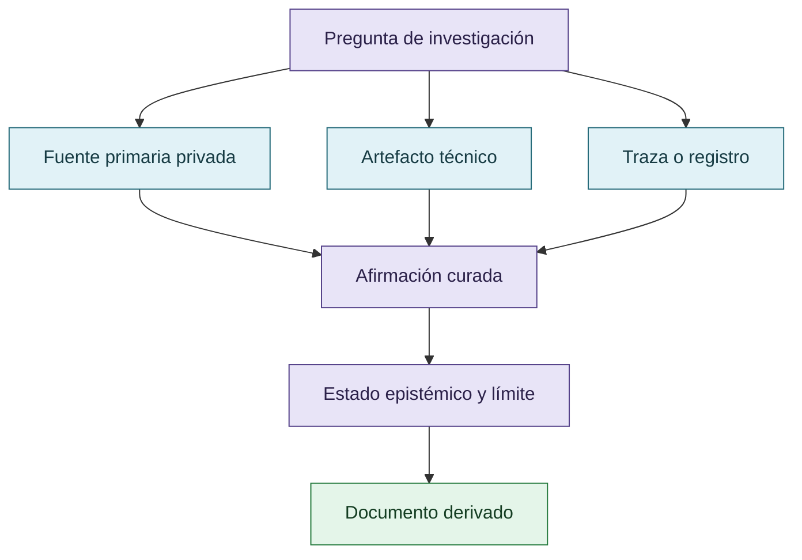

# Fuentes primarias y artefactos

## Jerarquía de artefactos

Las fuentes primarias sostienen afirmaciones distintas; ninguna reemplaza por sí sola al oráculo o al diseño experimental.

## Material privado

- `Downloads/reward_hacking.md` — fuente primaria privada de la extracción; no publicada.
- `Downloads/prompt.md` — instrucciones privadas de trabajo; no publicada.
- `Downloads/discordia.md` — material privado complementario; no publicado como documento crudo.

## Artefactos externos

- [VIGÍA](https://github.com/annatchijova/vigia-intent-analysis)
- [CRONOS](https://github.com/annatchijova/cronos)
- [MNEME](https://github.com/annatchijova/mneme)
- [CRUCIBLE](https://github.com/annatchijova/crucible) — pendiente de confirmar el repositorio exacto.
- [DISCORDIA](https://github.com/annatchijova/discordia)
- [Jacobian Lens](https://github.com/anthropics/jacobian-lens)
