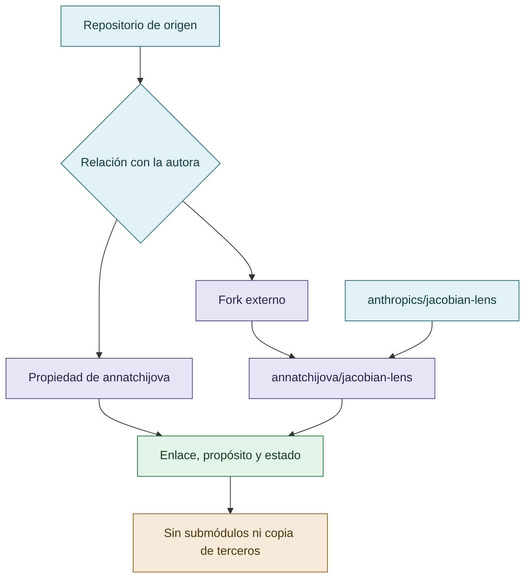

# Repositorios y forks

## Procedencia de repositorios

El inventario distingue propiedad, fork y origen; un enlace no borra la autoría ni la procedencia del repositorio padre.

## Repositorios de la autora

Estos repositorios ya pertenecen a la cuenta de la autora; GitHub no permite que una cuenta sea simultáneamente dueña del repositorio padre y de un fork del mismo repositorio.

- [VIGÍA — vigia-intent-analysis](https://github.com/annatchijova/vigia-intent-analysis)
- [SKILLS](https://github.com/annatchijova/SKILLS)
- [CRONOS](https://github.com/annatchijova/cronos)
- [MNEME](https://github.com/annatchijova/mneme)
- [DISCORDIA](https://github.com/annatchijova/discordia)
- [Reward hacking social](https://github.com/annatchijova/reward-hacking-social)

## Fork creado

- [jacobian-lens fork de annatchijova](https://github.com/annatchijova/jacobian-lens) — fork creado desde [anthropics/jacobian-lens](https://github.com/anthropics/jacobian-lens).

## Estado operativo

No se hizo `git push` del repositorio local. Los forks no se incorporan como submódulos ni se copian dentro de este repositorio; se mantienen como enlaces para preservar separación de procedencia.
